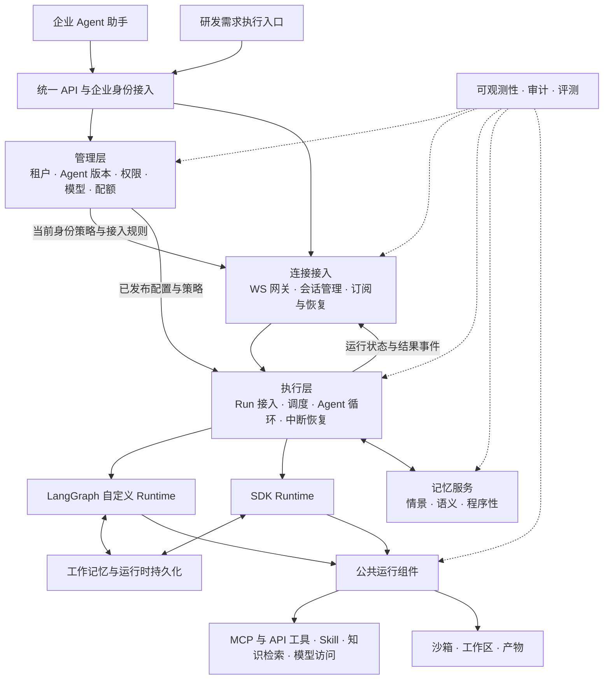

# 企业 Agent 整体架构

这套基座包含管理层、连接接入模块、执行层、记忆服务和公共组件，采用 **Agent Runtime＋Skill＋工具** 组织任务执行，不单独建设 Workflow 模块。它同时支撑企业 Agent 助手与研发需求执行，功能范围覆盖配置发布、会话交互、授权执行、记忆积累、工具和环境管理、结果留存及质量验证。

“小而全”落实在部署和实现方式上。先以少量服务和成熟基础设施承载完整职责，通过清晰接口保留拆分空间。下文是共同整理的目标设计，实施范围、个人贡献和上线日期需与实际项目记录对应。本文更新于 2026 年 11 月 16 日，引用的当前资料用于验证设计边界，7 月交付范围在时间线中单独确认。

## 细知识点目录

- [对这个设计的判断](#对这个设计的判断)
- [总体架构](#总体架构)
- [Agent Runtime 与 Skill 的执行方案](#agent-runtime-与-skill-的执行方案)
- [各模块的职责与核心对象](#各模块的职责与核心对象)
- [用一条需求串起所有模块](#用一条需求串起所有模块)
- [小规模部署建议](#小规模部署建议)
- [功能齐全如何落到验收](#功能齐全如何落到验收)

## 对这个设计的判断

管理层回答“谁能配置和使用哪些能力”，连接接入模块回答“请求属于谁、哪段会话，怎样持续交互”，执行层回答“一次任务如何运行”，记忆服务回答“哪些信息值得保留及如何复用”，公共组件提供实际动作、环境和治理能力。企业助手与需求流水线共享这套基座，各自组织业务入口和完成条件。

进一步细化时，重点明确以下边界。

| 容易混淆的部分 | 本方案的划分 |
| --- | --- |
| 连接与任务 | 网关承载 WS 与订阅，Session 保存会话，执行层维护 Run；断线不会自动取消任务 |
| 会话顺序与 Worker 调度 | 会话模块定义同会话任务规则，执行层原子裁决执行资格并分配 Worker |
| 模型配置与模型调用 | 管理层管理模型目录和策略，执行路径落实调用、限流、降级与用量记录 |
| 上下文与记忆 | 执行层组装本次上下文，Runtime 持有工作状态，记忆服务管理长期条目 |
| 工具、Skill 的管理与使用 | 管理层提供注册和发布入口，运行组件负责装载、鉴权和调用 |
| 权限与可观测性 | 权限策略由管理层定义，各访问点执行检查，观测贯穿整个运行链路 |
| 任务方法与执行保证 | Skill 描述步骤和完成要求，Runtime 驱动 Agent 循环，工具服务检查关键业务条件 |
| 基座运行与业务状态 | 基座管理 Run 生命周期，需求、验收和发布等业务对象由对应服务维护 |

四层记忆采用你确认的工作记忆、情景记忆、语义记忆和程序性记忆。这里的“层”表示四类职责，数据可以共享存储基础设施。它参考工作记忆加三类长期记忆的概念框架，具体生命周期按本项目需求设计，详见 [四层记忆服务](../05-memory/README.md)。

## 总体架构

图中的工作记忆与运行时持久化表示一类职责。LangGraph 和 SDK 分别维护各自的恢复数据，适配器管理引用和兼容性。执行层的 Context Assembler 调用记忆与知识服务，决定哪些内容进入本次模型输入。SDK 内部上下文管理按其开放能力接入。

公共组件各自提供管理接口和运行接口。管理界面可以集中在控制台，底层服务通过统一身份和版本引用连接。模型网关、工具网关、记忆服务等逻辑模块可按团队技术栈合并部署。

[连接接入模块](../02-connection/README.md)包括连接网关与会话管理两个逻辑部分。先做轻量接入与共享状态，按发布和扩容需求再拆独立服务。客户端 WS 不透传到 Worker，网关重启后重新鉴权、恢复订阅和状态；执行层继续维护原 Run。面向后台系统的入口可以直接提交可信执行命令，不要求先建立 WS。

[上下文与渐进式加载](../04-context/README.md)作为执行层内的独立职责展开，统一协调工具定义、Skill 指令、知识片段与产物内容的按需装载。资源的注册、授权、索引及存储由各模块负责，进入本轮模型请求的材料由上下文模块按任务和预算选择。

## Agent Runtime 与 Skill 的执行方案

AgentVersion 配置允许使用的 Skill、模型、工具、运行约束和结果要求。连接模块完成请求校验与会话关联，执行层幂等创建 Run、固定快照并调度 Worker，随后 Runtime 启动 Agent 循环；模型根据任务和工具反馈选择方法、加载资源并决定下一步。入口已经明确使用的 Skill 可以校验后直接加载，其他 Skill 按需发现，也允许无需 Skill 的简单任务直接调用工具。

Skill 可以描述整个任务的方法，包括步骤、分支判断、参考资料、脚本和完成要求。Agent Skills 的格式支持把指令及资源打包并按需加载，本方案沿用这一能力。[Agent Skills 概述](https://agentskills.io/home)

平台不维护独立的流程画布、Workflow DSL、业务节点连线或流程模板版本。运行中的计划与进度保存在工作状态中，可以依据反馈调整；Skill 的依赖声明用于加载和兼容性校验，不会自动生成执行图。Runtime 仍持久化运行、等待、恢复、取消和终态，并落实预算、重试与工具调用控制。Run 状态机服务于可靠执行，不要求业务任务预先定义一张流程图。

关键条件由程序执行检查。例如 Skill 指导“修改代码、运行测试、提交发布申请”，发布服务实际核验目标代码或产物版本对应的测试记录与审批条件；权限和凭证入口保证受控操作经过该服务。条件不满足时返回明确原因，Agent 据此继续处理或等待人工。技术执行完成与业务验收通过分别记录。

LangGraph 可以作为内部 Agent 循环、持久化和中断机制的实现选项，SDK 则通过适配器复用已有 Runtime 能力。两种路径都不要求租户配置业务 Workflow，具体职责见 [Agent 循环与 Runtime 适配](../03-execution/README.md#agent-循环与-runtime-适配)。

## 各模块的职责与核心对象

| 部分 | 主要职责 | 核心对象 |
| --- | --- | --- |
| 管理层 | 租户和工作区、身份权限、Agent 发布、模型与能力目录、审批规则、配额 | Tenant、Workspace、Agent、AgentVersion、Policy、ModelProfile |
| 连接接入 | 连接认证、请求规范化、会话归属与历史、操作分类、订阅推送和状态同步 | Connection、Subscription、Session、Message |
| 执行层 | 运行创建、会话执行资格、任务调度、Agent 循环、工具调用、上下文、等待恢复、取消与事件 | Run、Attempt、RuntimeSessionRef、CheckpointRef、RunEvent |
| 记忆服务 | 长期记忆候选、发布、检索、更正、撤销与删除，关联运行中的工作记忆 | MemoryEntry、MemoryVersion、SourceRef、Scope |
| 公共组件 | 企业工具、Skill、RAG、模型访问、沙箱、产物、观测与评测 | ToolVersion、SkillVersion、EnvironmentTemplate、Artifact、Trace、Evaluation |

### 统一运行对象

- **AgentVersion** 是不可变的发布版本，固定 Prompt、Skill、模型配置、工具、Runtime 及其他依赖引用。
- **Connection** 表示一次传输连接，关闭后重建；一个 Session 可以有多个页面连接与订阅。
- **Session** 承载连续交互，包含多个 Run。会话模块维护归属和历史，执行层维护其与执行器会话的映射。
- **Run** 表示一次逻辑调用，固定 AgentVersion。人工补充信息和失败恢复可以延续该 Run。
- **Attempt** 表示一次 Worker 执行尝试，承担租约、环境和执行所有权。一个 Run 可有多个 Attempt。
- **external_ref** 关联需求 Task、工单等上层业务对象，业务状态由对应应用维护。

服务端建立可信执行上下文，传递 `tenant_id`、`workspace_id`、`subject`、`agent_version_id`、`session_id`、`run_id`、`attempt_id`、`trace_id` 及策略、凭证引用。运行中的凭证按需获取，模型与工具输入不能覆盖身份字段。

同一 Session 默认只允许一个独立主 Run 驱动共享 Runtime 会话，由执行层原子持有执行资格。等待输入期间可以释放 Worker，但仍保留会话资格；新任务排队，补充输入和取消命令直接作用于原 Run。并行子任务使用独立上下文和子 Run，通过父子关系汇总结果、权限及用量。

## 用一条需求串起所有模块

以“订单列表增加创建人筛选”为讲解例子，具体业务样例可替换成真实项目记录。

1. 需求流水线保存范围、验收条件和仓库基线，调用基座时传入 `external_ref`。
2. 连接模块校验身份、请求和会话归属，按操作类型转交可信命令；管理层提供发布配置与当前策略。
3. 执行层复核访问权限，幂等创建 Run 与快照，可靠入队。取得会话执行资格后，Worker 取得租约，建立 Attempt 和工作区。
4. 上下文组装器读取当前输入与工作状态，检索相关经历、项目约定和知识证据。任务已指定的方法直接校验加载，其余 Skill 按需搜索、选择和加载。
5. Runtime 驱动 Agent 循环，模型依据 Skill 和工具反馈形成计划、实施修改并检查结果。企业工具执行参数、权限和业务前置条件校验，命令和脚本在限定环境内执行。
6. 需要人工输入时持久化等待状态，恢复前核验当前权限、执行环境和未决外部操作。
7. 按预先确定的结果要求校验并保存证据，结果与必要产物持久化后提交 Run 终态。连接模块向订阅者展示进度和结果，断线后查询原 Run 恢复展示。需求服务保存交付与验收状态；任务涉及 CI、审查或发布时，通过对应工具服务提交并检查结果，发布条件绑定实际代码或产物版本。
8. 记忆服务基于执行结果及后续验证记录提炼候选。已确认事实和可复用经验按规则发布，程序性改进形成新的 Skill 或 Prompt 版本。

一次任务中，工作记忆跟踪当前修改与测试，情景记忆记录这次经历，语义记忆保存确认过的项目约定，程序性记忆提供已发布的实现和检查方法。验证尚未完成的结论保留待验证状态，后续结果到达后更新。

## 小规模部署建议

结合现有笔记中的技术栈，可以先采用下面的部署方式。表中是实现选项，最终选择以团队已有设施和实际部署记录为准。

| 部署单元 | 首期承载职责 |
| --- | --- |
| Web 工作台 | Agent 配置、运行交互、审批、产物与观测入口 |
| 接入与管理后端 | 连接网关、会话管理、管理层、Run 元数据与调度、工具治理和业务集成，按逻辑模块组织；业务发布影响连接时独立部署连接网关 |
| Python 服务及后台 Worker | 基于 LangGraph 的 Agent 循环、上下文组装、已有 RAG、记忆查询与异步提炼 |
| SDK Worker 与执行环境 | SDK 适配、会话和工作区管理、代码与命令执行、事件及产物回收 |

已有关系库可保存平台配置、会话与消息、运行状态、权限、记忆主记录与 outbox。对象存储保存文件和归档，检索系统保存可重建索引。队列承担调度信号传递，缓存承担加速和临时连接路由，任务权威状态落在持久化存储中。消息投递到连接只是展示通道，不能作为任务或事件唯一保存位置。

checkpoint 与 SDK 会话需要各自兼容的持久化方案。选型时验证框架支持的存储、恢复语义和升级兼容性，再决定复用已有设施或增加对应存储。SDK 的本地会话目录如用于跨进程恢复，需有持久化、隔离、访问控制及备份安排。

模块拆分的触发条件是独立扩缩容、故障隔离或维护边界。例如编码 Worker 资源波动较大，可以先独立扩容，配置和目录管理继续放在同一后端。

## 功能齐全如何落到验收

| 能力 | 最小可验证结果 |
| --- | --- |
| 管理层 | 能创建租户与工作区、发布 Agent、回滚版本、撤销权限、配置模型和配额 |
| 连接接入 | 能校验请求和会话归属、多页面交互、订阅推送、换网关后恢复状态，发布时有界排空 |
| 执行层 | 能幂等创建任务、协调会话执行资格、运行 Agent 循环、按需加载 Skill 与调用工具，检查结果，人工等待后恢复，取消并核对副作用 |
| 四层记忆 | 能使用工作状态、提炼经历、修订事实、装载程序性版本，并执行作用域过滤和撤销 |
| 工具与 Skill | 能完成注册、版本固定、鉴权调用、失败分类、升级与回滚 |
| 环境与产物 | 能隔离执行、保存恢复材料、提交可校验产物，并在结束后回收环境 |
| 观测与评测 | 能按 Run 排查问题，区分执行完成与业务验收，比较版本的质量及成本 |

验收记录关联配置版本、执行结果和故障处理证据，各模块据此确认最小功能是否完整。

## 对应案例

[查看 00-overview 案例](../../case/00-overview/README.md)。

[返回知识清单](../README.md)
