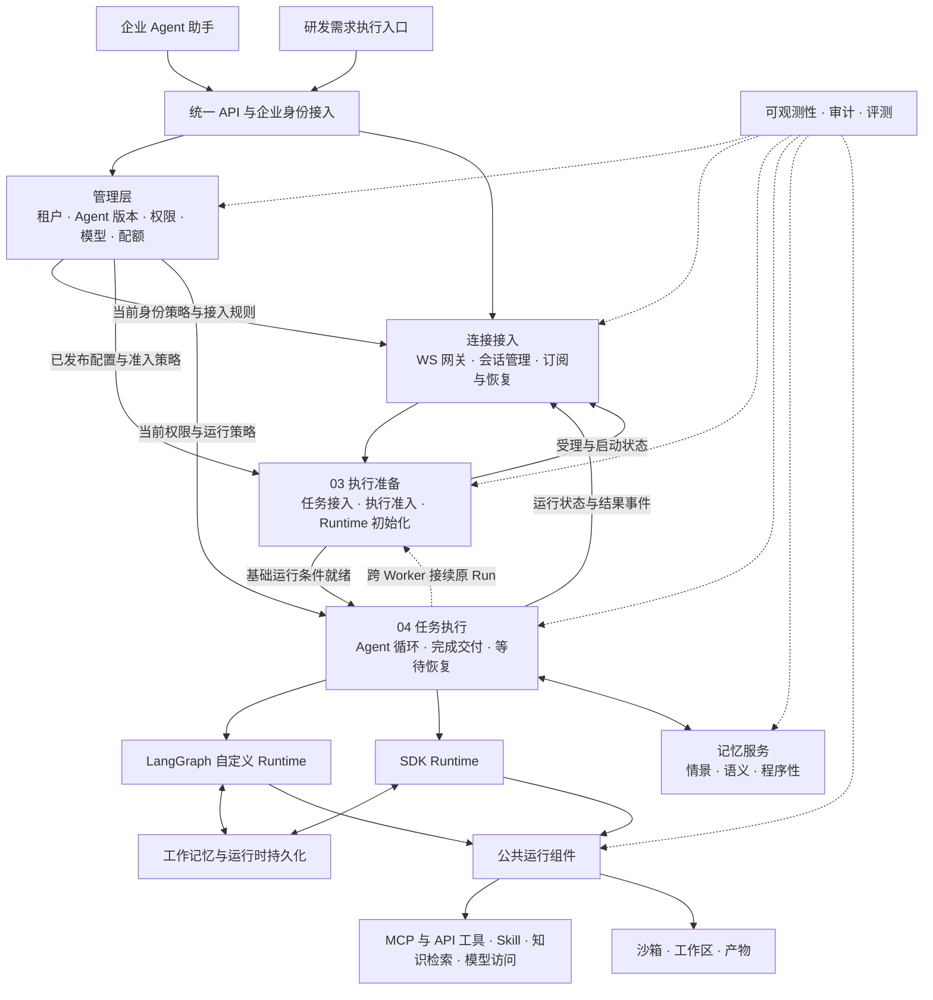

# 企业 Agent 整体架构

这套基座包含管理层、连接接入、执行准备、任务执行、记忆服务和公共组件，采用 **Agent Runtime＋Skill＋工具** 组织任务执行，不单独建设 Workflow 模块。它同时支撑企业 Agent 助手与研发需求执行，功能范围覆盖配置发布、会话交互、授权执行、记忆积累、工具和环境管理、结果留存及质量验证。

“小而全”落实在部署和实现方式上。先以少量服务和成熟基础设施承载完整职责，通过清晰接口保留拆分空间。下文是共同整理的目标设计，实施范围、个人贡献和上线日期需与实际项目记录对应。本文更新于 2026 年 11 月 17 日，引用的当前资料用于验证设计边界，7 月交付范围在时间线中单独确认。

## 细知识点目录

- [对这个设计的判断](#对这个设计的判断)
- [总体架构](#总体架构)
- [Agent Runtime 与 Skill 的执行方案](#agent-runtime-与-skill-的执行方案)
- [各模块的职责与核心对象](#各模块的职责与核心对象)
- [用一条需求串起所有模块](#用一条需求串起所有模块)
- [小规模部署建议](#小规模部署建议)
- [功能齐全如何落到验收](#功能齐全如何落到验收)

## 对这个设计的判断

管理层回答“谁能配置和使用哪些能力”，连接接入模块回答“请求属于谁、哪段会话，怎样持续交互”，执行准备回答“能否受理、由谁执行、基础条件是否就绪”，任务执行回答“如何决策、行动、检查并交付”，记忆服务回答“哪些信息值得保留及如何复用”，公共组件提供实际动作、环境和治理能力。企业助手与需求流水线共享这套基座，各自组织业务入口和完成条件。

进一步细化时，重点明确以下边界。

| 容易混淆的部分 | 本方案的划分 |
| --- | --- |
| 连接与任务 | 网关承载 WS 与订阅，Session 保存会话，执行准备创建 Run，任务执行推进同一 Run；断线不会自动取消任务 |
| 准备与循环 | 准备负责受理、归属、Runtime 初始化和可信运行信息；执行统一组装首轮与后续模型输入并驱动决策与动作，两者可在同一服务实现 |
| 会话规则与执行准入 | 会话模块定义同会话任务规则，目标执行实例原子预占槽位并裁决执行资格；满载直接拒绝 |
| 模型配置与模型调用 | 管理层管理模型目录和策略，执行路径落实调用、限流、降级与用量记录 |
| 上下文与记忆 | 执行层组装本次上下文，Runtime 持有工作状态，记忆服务管理长期条目 |
| 工具、Skill 的管理与使用 | 管理层提供注册和发布入口，运行组件负责装载、鉴权和调用 |
| 权限与可观测性 | 权限策略由管理层定义，各访问点执行检查，观测贯穿整个运行链路 |
| 任务方法与执行保证 | Skill 描述步骤和完成要求，Runtime 驱动 Agent 循环，工具服务检查关键业务条件 |
| 基座运行与业务状态 | 基座管理 Run 生命周期，需求、验收和发布等业务对象由对应服务维护 |

四层记忆采用你确认的工作记忆、情景记忆、语义记忆和程序性记忆。这里的“层”表示四类职责，数据可以共享存储基础设施。它参考工作记忆加三类长期记忆的概念框架，具体生命周期按本项目需求设计，详见 [四层记忆服务](../06-memory/README.md)。

## 总体架构

[执行准备](../03-preparation/README.md)与 [任务执行](../04-execution/README.md) 是并列的逻辑模块，可部署在同一服务中，共用同一份 Run 与 Attempt 权威记录。准备为每个新 Attempt 建立或恢复基础 Runtime，交付可信运行信息及必要状态；首轮、后续轮次和恢复后的模型输入，都由任务执行中的同一个上下文组装器生成，准备层不另写初始化 Prompt 逻辑。局部重试和页面重连不重新初始化，跨 Worker 恢复则沿原 Run 返回准入与初始化，保留配置快照、已用预算和总截止时间。租约与当前权限在运行中持续检查，归入准备模块不表示只检查一次。

图中的工作记忆与运行时持久化表示一类职责。LangGraph 和 SDK 分别维护各自的恢复数据，适配器管理引用和兼容性。任务执行中的 Context Assembler 调用记忆与知识服务，决定哪些内容进入本次模型输入。SDK 内部上下文管理按其开放能力接入。

公共组件各自提供管理接口和运行接口。管理界面可以集中在控制台，底层服务通过统一身份和版本引用连接。模型网关、工具网关、记忆服务等逻辑模块可按团队技术栈合并部署。

[连接接入模块](../02-connection/README.md)包括连接网关与会话管理两个逻辑部分。先做轻量接入与共享状态，按发布和扩容需求再拆独立服务。客户端 WS 不透传到 Worker，网关重启后重新鉴权、恢复订阅和状态；执行层继续维护原 Run。面向后台系统的入口可以直接提交可信执行命令，不要求先建立 WS。

[上下文与渐进式加载](../05-context/README.md)作为执行层内的独立职责展开，统一协调工具定义、Skill 指令、知识片段与产物内容的按需装载。资源的注册、授权、索引及存储由各模块负责，进入本轮模型请求的材料由上下文模块按任务和预算选择。

## Agent Runtime 与 Skill 的执行方案

AgentVersion 配置允许使用的 Skill、模型、工具、运行约束和结果要求。连接模块完成校验与会话关联，将新请求在健康同构执行实例间均匀随机分发。目标实例先检查幂等，再预占槽位、检查 Session 资格和租户额度，可靠提交 Run、快照与执行归属后才受理，随后启动 Runtime；模型根据任务和工具反馈选择方法、加载资源并决定下一步。入口已明确使用的 Skill 可以校验后直接加载，其他 Skill 按需发现，也允许简单任务直接调用工具。

执行准备中的任务接入和 [执行准入与归属管理](../03-preparation/02-scheduling/README.md) 是共同完成受理的逻辑职责，不能先承诺受理再检查执行资源。新任务不排队，也不由 Worker 主动领取；目标实例满时快速拒绝，不自动查找最闲实例或换节点重试。均匀随机分发只使长期请求数近似平均，任务时长不同仍会造成实时负载差异。

Skill 可以描述整个任务的方法，包括步骤、分支判断、参考资料、脚本和完成要求。Agent Skills 的格式支持把指令及资源打包并按需加载，本方案沿用这一能力。[Agent Skills 概述](https://agentskills.io/home)

平台不维护独立的流程画布、Workflow DSL、业务节点连线或流程模板版本。运行中的计划与进度保存在工作状态中，可以依据反馈调整；Skill 的依赖声明用于加载和兼容性校验，不会自动生成执行图。Runtime 仍持久化运行、等待、恢复、取消和终态，并落实预算、重试与工具调用控制。Run 状态机服务于可靠执行，不要求业务任务预先定义一张流程图。

关键条件由程序执行检查。例如 Skill 指导“修改代码、运行测试、提交发布申请”，发布服务实际核验目标代码或产物版本对应的测试记录与审批条件；权限和凭证入口保证受控操作经过该服务。条件不满足时返回明确原因，Agent 据此继续处理或等待人工。技术执行完成与业务验收通过分别记录。

LangGraph 可以作为内部 Agent 循环、持久化和中断机制的实现选项，SDK 则通过适配器复用已有 Runtime 能力。两种路径都不要求租户配置业务 Workflow，具体职责见 [Agent 循环与 Runtime 适配](../04-execution/README.md#agent-循环与-runtime-适配)。

## 各模块的职责与核心对象

| 部分 | 主要职责 | 核心对象 |
| --- | --- | --- |
| 管理层 | 租户和工作区、身份权限、Agent 发布、模型与能力目录、审批规则、配额 | Tenant、Workspace、Agent、AgentVersion、Policy、ModelProfile |
| 连接接入 | 连接认证、请求规范化、会话归属与历史、操作分类、订阅推送和状态同步 | Connection、Subscription、Session、Message |
| 03 执行准备 | 可信任务接入、幂等受理、执行准入、Run 与快照创建、Session 资格、执行归属、Runtime 基础初始化 | Run、Attempt、RuntimeSessionRef、配置快照与租约 |
| 04 任务执行 | 多轮 Agent 决策、上下文与工具调用、循环控制、完成验收、等待恢复、取消与事件 | 同一 Run、CheckpointRef、RunEvent、操作记录与产物 |
| 记忆服务 | 长期记忆候选、发布、检索、更正、撤销与删除，关联运行中的工作记忆 | MemoryEntry、MemoryVersion、SourceRef、Scope |
| 公共组件 | 企业工具、Skill、RAG、模型访问、沙箱、产物、观测与评测 | ToolVersion、SkillVersion、EnvironmentTemplate、Artifact、Trace、Evaluation |

### 统一运行对象

- **AgentVersion** 是不可变的发布版本，固定 Prompt、Skill、模型配置、工具、Runtime 及其他依赖引用。
- **Connection** 表示一次传输连接，关闭后重建；一个 Session 可以有多个页面连接与订阅。
- **Session** 承载连续交互，包含多个 Run。会话模块维护归属和历史，执行准备建立与执行器会话的映射，任务执行沿用该映射。
- **Run** 表示一次逻辑调用，固定 AgentVersion。人工补充信息和失败恢复可以延续该 Run。
- **Attempt** 表示一次 Worker 执行尝试，承担租约、环境和执行所有权。一个 Run 可有多个 Attempt。
- **external_ref** 关联需求 Task、工单等上层业务对象，业务状态由对应应用维护。

服务端建立可信执行上下文，传递 `tenant_id`、`workspace_id`、`subject`、`agent_version_id`、`session_id`、`run_id`、`attempt_id`、`trace_id` 及策略、凭证引用。运行中的凭证按需获取，模型与工具输入不能覆盖身份字段。

同一 Session 默认只允许一个独立主 Run 驱动共享 Runtime 会话，由执行准备原子取得执行资格，任务执行沿用该资格。主 Run 未结束时拒绝新的独立任务；等待输入期间可以释放 Worker，但仍保留会话资格。补充输入、审批和取消走原 Run 控制通道。并行子任务使用独立上下文和子 Run，通过父子关系汇总结果、权限及用量。

## 用一条需求串起所有模块

以“订单列表增加创建人筛选”为讲解例子，具体业务样例可替换成真实项目记录。

1. 需求流水线保存范围、验收条件和仓库基线，调用基座时传入 `external_ref`。
2. 连接模块校验身份、请求和会话归属，按操作类型转交可信命令；管理层提供发布配置与当前策略。
3. 请求随机到达健康同构实例，由执行准备复核权限与幂等，相同请求返回原 ack。新任务原子预占实例槽位，条件占用 Session 资格与租户额度，可靠提交 `STARTING` 的 Run、快照、Attempt 的 owner/epoch/lease 和 ack 后才确认受理，再准备可信运行信息、配置与参数、运行会话和能力接口。本例已明确代码需求，可按任务要求准备必要工作区；通用问答不默认创建沙箱。确认未受理才释放预占并拒绝，提交结果未知先对账，不承诺排队后执行。
4. 基础条件就绪后进入任务执行，统一上下文组装器根据运行信息、当前输入与工作状态组织首轮模型输入；后续加入执行结果后继续调用同一入口。按需取得相关经历、项目约定和知识证据，任务已指定的方法直接校验加载，其余 Skill 按需搜索、选择和加载。
5. Runtime 驱动多轮 Agent 循环，模型依据 Skill 和工具反馈决定下一步、按需维护计划、实施修改并检查结果。企业工具执行参数、权限和业务前置条件校验，命令和脚本在限定环境内执行。
6. 需要人工输入时持久化等待状态，恢复前核验当前权限、实际依赖的环境和未决外部操作。跨 Worker 接续先由任务执行判断恢复边界，再返回执行准备取得新归属并恢复 Runtime，沿用原 Run、配置快照和剩余预算，不重做已发生的业务副作用。暂时无恢复容量时进入 `RECOVERY_PENDING` 并受原截止时间限制。
7. 按预先确定的结果要求校验并保存证据，结果与必要产物持久化后提交 Run 终态。连接模块向订阅者展示进度和结果，断线后查询原 Run 恢复展示。需求服务保存交付与验收状态；任务涉及 CI、审查或发布时，通过对应工具服务提交并检查结果，发布条件绑定实际代码或产物版本。
8. 记忆服务基于执行结果及后续验证记录提炼候选。已确认事实和可复用经验按规则发布，程序性改进形成新的 Skill 或 Prompt 版本。

一次任务中，工作记忆跟踪当前修改与测试，情景记忆记录这次经历，语义记忆保存确认过的项目约定，程序性记忆提供已发布的实现和检查方法。验证尚未完成的结论保留待验证状态，后续结果到达后更新。

## 小规模部署建议

结合现有笔记中的技术栈，可以先采用下面的部署方式。表中是实现选项，最终选择以团队已有设施和实际部署记录为准。

| 部署单元 | 首期承载职责 |
| --- | --- |
| Web 工作台 | Agent 配置、运行交互、审批、产物与观测入口 |
| 接入与管理后端 | 连接网关、会话管理、管理层、运行状态查询、工具治理和业务集成，按逻辑模块组织；业务发布影响连接时独立部署连接网关 |
| Python 服务及后台 Worker | 执行准备、基于 LangGraph 的 Agent 循环、上下文组装、已有 RAG、记忆查询与异步提炼 |
| SDK Worker 与执行环境 | 执行准备、SDK 适配、会话和工作区管理、代码与命令执行、事件及产物回收 |

执行准备与任务执行可以由同一执行服务承载，目录划分不要求额外增加一次跨服务调用。参与随机分发的对外执行实例提供相同的 Runtime 能力，表中的 Python 与 SDK 执行能力可作为实例内部适配或依赖环境。不能把能力互斥的 Worker 混入同一个随机分发池，再期待任意实例都能受理相同任务。

已有关系库可保存平台配置、会话与消息、运行状态、执行归属、权限、记忆主记录与 outbox。对象存储保存文件和归档，检索系统保存可重建索引。新任务直接进入目标实例的准入过程，不依赖调度 MQ；outbox 继续支持可靠状态通知，缓存承担加速和临时连接路由。任务权威状态落在持久化存储中，消息投递到连接只是展示通道。

健康检查用于决定哪些同构实例可接收新请求，槽位检查在目标实例完成。已经可靠受理但尚未启动成功的任务属于原 Run 的执行责任，不能因实例故障改成“未受理”或新建 Run；通过持久状态扫描发现孤立的 `STARTING` 与失效 owner，完成核对后接续或明确结束。

checkpoint 与 SDK 会话需要各自兼容的持久化方案。选型时验证框架支持的存储、恢复语义和升级兼容性，再决定复用已有设施或增加对应存储。SDK 的本地会话目录如用于跨进程恢复，需有持久化、隔离、访问控制及备份安排。

模块拆分的触发条件是独立扩缩容、故障隔离或维护边界。例如编码 Worker 资源波动较大，可以先独立扩容，配置和目录管理继续放在同一后端。

## 功能齐全如何落到验收

| 能力 | 最小可验证结果 |
| --- | --- |
| 管理层 | 能创建租户与工作区、发布 Agent、回滚版本、撤销权限、配置模型和配额 |
| 连接接入 | 能校验请求和会话归属、多页面交互、订阅推送、换网关后恢复状态，发布时有界排空 |
| 03 执行准备 | 能随机分发、原子准入并在满载时拒绝，幂等返回原 Run，为每个 Attempt 建立或恢复基础 Runtime |
| 04 任务执行 | 能进行多轮 Agent 决策，按需使用能力并检查结果，验收交付，故障或人工等待后沿原 Run 恢复，取消并核对副作用 |
| 四层记忆 | 能使用工作状态、提炼经历、修订事实、装载程序性版本，并执行作用域过滤和撤销 |
| 工具与 Skill | 能完成注册、版本固定、鉴权调用、失败分类、升级与回滚 |
| 环境与产物 | 能隔离执行、保存恢复材料、提交可校验产物，并在结束后回收环境 |
| 观测与评测 | 能按 Run 排查问题，区分执行完成与业务验收，比较版本的质量及成本 |

验收记录关联配置版本、执行结果和故障处理证据，各模块据此确认最小功能是否完整。

## 对应案例

[查看 00-overview 案例](../../case/00-overview/README.md)。

[返回知识清单](../README.md)
