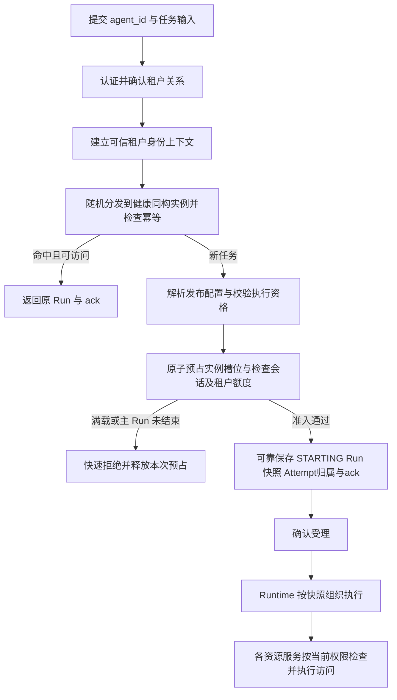

# 租户配置服务与执行权限

租户配置服务属于管理层（Management），集中管理租户的可用资源、权限策略和配额，并提供统一读取入口。Agent 运行时根据可信租户身份取得配置，在租户允许范围内使用自己启用的能力；Runtime 和资源服务负责在实际访问时落实限制。

## 职责归属

管理层的职责是配置与治理，包括配置保存、有效性校验、版本发布、回滚、停用和变更审计。租户配置模块可以与 Agent 管理模块放在同一个后端进程中，按职责组织接口和数据。

| 模块 | 负责的事情 |
| --- | --- |
| 管理层 | 管理租户和 Agent 配置，提供可校验的配置版本及当前有效策略 |
| 认证入口 | 验证调用身份和租户关系，建立可信身份上下文 |
| 连接与会话模块 | 规范化请求，检查会话归属与订阅资格，转交任务命令并恢复展示 |
| 任务接入与执行准入 | 幂等检查、实例槽位预占、会话资格与租户额度校验，可靠保存 Run、快照和执行归属后受理 |
| Runtime | 读取运行配置，组织模型和工具调用，控制运行预算 |
| Skill、工具、知识等服务 | 根据执行上下文和有效配置，限制实际访问的资源和动作 |

模型调用、任务循环、工具执行和状态恢复由执行层承担。Skill 包、知识正文等资源由各自模块维护，管理层保存引用及配置关系。

## 配置内容与读取入口

平台管理员配置租户可获得的能力，租户管理员在平台允许的范围内配置租户与 Agent。租户配置确定能力上限，AgentVersion 固定当前 Agent 选择的能力及版本。

| 配置对象 | 主要内容 |
| --- | --- |
| 租户配置 | 启停状态、可用模型、Skill 授权、工具及知识范围、并发和用量配额 |
| Agent 配置 | 从租户可用范围中选择的模型、Skill 和工具，以及版本、Prompt、Runtime、运行预算与结果要求 |

配置可以通过统一管理后台修改。对外创建任务只传 `agent_id`、输入和幂等键，服务端先检查幂等；相同请求命中原 Run 时校验访问权并返回原 ack，不重复预占额度或解析新版。未命中的新请求才解析当前发布版本，经目标实例准入并可靠保存 Run 与配置快照后受理。运行中的配置读取使用内部接口，一个最小契约可以是：

```text
get_effective_config(trusted_context, run_id)

输入：可信租户及调用主体、run_id
返回：该 Run 的固定配置快照、当前租户与 Agent 状态、有效资源范围及策略修订号
```

这里的“有效配置”由该 Run 的固定能力范围与当前租户、Agent 限制共同确定。服务端先校验 Run 的归属及访问资格，再读取其配置引用，不以最新发布版本覆盖旧快照。可以由公共模块或内部客户端复用读取逻辑，不要求每次工具调用都远程读取全部配置。模型不负责构造上述可信上下文。

配置接口统一返回资源引用即可。例如 Skill 的授权与绑定由管理层管理，名称、描述、标签和包内容仍从 Skill 服务取得。详见 [多租户 Skill 配置存储与运行时加载](../08-skills/01-多租户Skill配置存储与运行时加载.md)。

AgentVersion 不需要绑定 Workflow 模板。Runtime 取得有效配置后启动 Agent 循环，按任务加载已授权的 Skill、使用工具，并记录执行状态；租户配置只决定能力范围和限制，不预先规定业务步骤的执行图。

## 可信租户身份与执行链路

先确认租户身份，再读取该租户的配置。请求入口验证用户或服务身份；用户可以选择自己所属的租户，服务端检查这个选择后建立 `tenant_id`。前端字段、Prompt 或模型生成的参数不能直接决定执行租户。



新请求默认在健康同构实例间均匀随机分发，目标实例满时拒绝，不自动找最闲实例或换节点重试。执行层 01 任务接入与 [02 执行准入与归属管理](../03-execution/02-scheduling/README.md) 共同完成准入和可靠提交，保存 `STARTING` Run、快照、Attempt 的 owner/epoch/lease 与 ack 后才受理。新任务不排队；同 Session 主 Run 未结束时拒绝新的独立任务，补充输入、审批和取消直接交给原 Run。

创建 Run 时关联租户、调用主体、AgentVersion 和配置快照。后续服务调用与 Worker 执行沿用这份服务端上下文，并关联 Run 与 Trace；通过 Run 引用解析版本，不要求客户端每次传版本号。内部调用链路仍检查身份与目标资源的关系。已受理任务故障后保留原 Run、租约与 fencing，扫描后按预算和截止时间有限恢复；无容量时明确记录 `RECOVERY_PENDING`。

## 有效范围与实际校验

对于 Skill、模型、工具等能力选择，可以先用下面的关系理解：

```text
当前 Agent 可使用的能力
  = Run 快照中的能力范围 ∩ 当前租户可用范围 ∩ 当前 Agent 有效限制
```

例如租户 A 可使用 S1、S2、S3，某个 AgentVersion 只启用 S1 和 S3，且没有额外停用，那么这次运行的 Skill 搜索与加载范围就是 S1、S3。若当前策略禁用 S3，旧 Run 的后续访问也只能使用 S1。各项能力仍引用该 Run 固定的版本，具体动作还受调用主体与任务范围约束。

全局 Skill、租户自有 Skill、获授权定制 Skill 先合并为租户可用范围，再参与上述交集。工具动作和业务数据访问继续遵守对应系统已有权限，Skill 可用本身不会扩大这些权限。

统一的是配置来源与身份传递方式，实际检查由执行路径落实：Skill 服务限制搜索与加载，工具服务检查工具及操作范围，知识服务限制检索数据，Runtime 与执行准入组件控制模型选择、预算和并发。把配置写进 Prompt 不能代替这些检查。

## 配置版本与缓存更新

AgentVersion 固定 Prompt、Skill 等依赖，Run 快照保存本次实际采用的配置，支持复现与恢复。租户、Agent 和版本的当前状态及授权决定这些依赖现在是否仍可访问：普通能力升级通过新 Run 生效，停用或撤权约束正在运行的任务。

固定版本与 Run 快照可以缓存；发布指针和当前权限需要分别处理更新与失效。缓存键区分租户、版本或快照标识及相关修订号，按请求主体变化的结果还需区分主体。不可变内容可复用，普通缓存可以通过通知或过期更新；严格要求撤权生效的关键动作读取权威当前状态，不能只等待 TTL 或通知送达，无法确认时不发起该动作。

管理层维护变更记录并传播失效通知，执行层和资源服务处理受影响的后续动作。固定配置版本与当前权限检查分别解决可复现性和访问有效性，两者同时保留。

已经通过授权检查或发出的外部请求仍可能完成，撤权后需尽力取消并核查结果。对外无版本、服务实例无状态，以及快照与当前权限的完整边界见 [Agent 配置发布与运行快照](./03-Agent配置发布与运行快照.md)。

[返回管理层](./README.md) · [执行上下文](../03-execution/README.md#运行对象与可信上下文) · [返回知识清单](../README.md)
