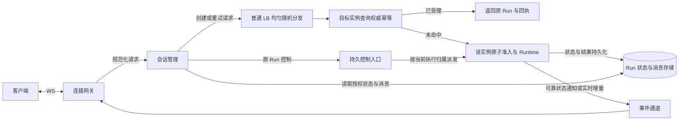

# 连接接入与会话协作

连接接入模块承接客户端请求、会话交互与实时结果展示，位于管理层配置和执行层任务运行之间。客户端 WebSocket 由连接网关处理，任务交给独立 Worker 执行；页面断线或网关发布后，客户端恢复连接与业务状态，已经接收的 Run 继续由执行层管理。

本模块拆分为连接网关与会话管理两个逻辑部分。初期可部署在同一个接入服务中，对外称执行网关；业务发布频繁或连接规模增长时，可以独立部署轻量连接网关与会话服务。独立运行的 Worker 不放进 WS 连接处理函数，也不跟随连接退出而取消。

会话管理保存 Session 归属、消息历史和任务关联；连接网关维护 WS 的认证、心跳、订阅和关闭。Session 可以没有在线连接，也可以被多个页面同时访问，因此连接心跳维护的是 Connection，不是给持久会话续命。Worker 的执行心跳与租约由执行层维护。

数据存储分为三部分：MySQL 保存会话与任务的持久记录，Redis 保存热点缓存和可重建的连接路由，本机内存持有实际 Socket、缓冲与连接心跳。Redis 临时路由不要求都有数据库副本；执行归属与租约由执行层的权威记录裁决。具体见 [数据库与 Redis 的分工](./02-连接路由与事件推送.md#数据库与-redis-的分工)。

## 细知识点目录

| 阅读顺序 | 专题 | 要讲清楚的问题 |
| --- | --- | --- |
| 01 | [请求处理与会话协作](./01-请求处理与会话协作.md) | 请求怎样规范化，Session 怎样归属，输入如何关联新任务或已有 Run |
| 02 | [连接路由与事件推送](./02-连接路由与事件推送.md) | 数据库、Redis 与本机内存如何分工，多实例路由、重连与慢客户端怎样处理 |
| 03 | [断线重连与状态恢复](./03-断线重连与状态恢复.md) | 页面回来怎样继续，快照同步与完整事件回放各解决什么 |
| 04 | [发布排空与部署选型](./04-发布排空与部署选型.md) | 发布如何降低断连影响，何时拆服务，WS 与 SSE 如何选择 |
| 05 | [连接心跳与存活检测](./05-连接心跳与存活检测.md) | Ping/Pong、业务心跳、连接超时与路由 TTL 如何配合，为什么不影响 Run |
| 参考 | [官方实践与设计边界](./参考实践与设计边界.md) | 哪些是协议或产品能力，哪些是本平台选择 |

## 模块边界

| 模块或职责 | 负责 | 权威数据或约束 |
| --- | --- | --- |
| 管理层 | 租户、Agent 版本、策略、配额及会话并发规则的配置 | 发布配置与当前有效策略 |
| 连接网关 | 连接认证、心跳、订阅、转发、事件推送、缓冲与排空 | 当前实例持有的连接；路由映射是可过期的运行信息 |
| 会话管理 | 会话归属、消息历史、Run 关联、输入分类及会话内顺序规则 | Session 与 Message；Run 状态只读取或投影执行层结果 |
| 执行层 | 承接 LB 请求、权威幂等查询、实例原子准入、任务控制与恢复 | Run、快照、Attempt、会话资格、额度、执行归属和租约 |
| 资源服务 | 模型、Skill、工具、知识、沙箱和产物访问 | 各自资源与当前访问权限 |

默认一个 Session 同时只有一个独立主 Run 驱动共享 Runtime 会话。新独立任务遇到已有主 Run 时快速拒绝，不排队；目标执行实例在可靠受理时原子裁决会话资格。等待用户输入仍保留该资格，必要时释放 Worker。补充、审批与取消可靠保存到原 Run 控制通道，不参与新任务随机分发。并行子任务使用独立上下文。

请求包含创建任务的重试，先经普通 LB 均匀随机到某个健康同构执行实例。该实例先查权威幂等记录，命中只返回原 Run 与 ack，不预占槽位、不改变原执行 owner；未命中才非阻塞原子预占槽位，满额立即拒绝。随机的是请求承接节点，不等于重新分配原 Run。本方案不设置新任务等待队列，不由 Worker 主动领取，也不设置中心容量调度或忙时自动换实例重试。随机仅近似均摊请求量，不保证实时负载相等，单实例满额也不代表集群全满。

连接网关和执行层分别校验各自操作的权限。通过一次 WS 握手不代表后续一直有权访问原会话，内部租户身份也不能仅依赖客户端自报字段。

## 请求与事件链路

图中存储是逻辑展示：Run 状态由执行层维护，展示消息由会话投影维护，可以共用数据库，但不能相互覆盖。outbox 用于状态通知等可靠投递，不再承担新任务调度入队；临时文本增量可以批量推送，不承诺每个 Token 都独立持久化。

目标实例取得槽位后，在同一可靠提交边界保存 `STARTING` 的 Run、配置快照、Session 资格、额度预占、Attempt 的 owner/epoch/lease 与原始回执，才能确认受理。任务接入与[执行准入与归属管理](../03-preparation/02-scheduling/README.md)是同一次受理的逻辑职责。实例满额时不创建已受理 Run。

持久化后、Runtime 启动前发生崩溃，仍须恢复原 Run 或明确失败。已受理任务恢复时无资源，显式进入 `RECOVERY_PENDING` 并有限重试至截止时间，不回报未受理，也不加入新任务等待队列。后续进度通过订阅返回，模型和工具由 Runtime 直接访问对应服务。

AWS API Gateway 的连接模型同样把客户端长连接与后端消息处理分开，后端集成不持有对应的持久连接。这支持按消息转交请求，但不自动提供本平台的会话、运行幂等和任务恢复。[AWS 连接模型](https://docs.aws.amazon.com/apigateway/latest/developerguide/api-gateway-basic-concept.html)

## 连接与任务生命周期

| 对象 | 用途 | 断线后如何处理 |
| --- | --- | --- |
| Connection | 一次 WS 连接和订阅上下文 | 失效后重建，连接标识通常变化 |
| Session | 用户持续交互的会话 | 按用户与租户授权重新查询，同一会话可有多个连接 |
| Run | 一次逻辑任务 | 查询原任务，不因重连重新创建 |
| Attempt | 一次 Worker 执行尝试 | 断线不新增；执行接续需要时才创建新的 Attempt |

第一档恢复能力是重连后查询当前状态、已有消息与结果，再衔接实时更新。需要完整步骤或文本增量时才增加持久事件和游标回放；游标过期仍回到状态同步。纯事件通知不能代替状态存储，具体衔接规则见 [断线重连与状态恢复](./03-断线重连与状态恢复.md)。

微软的长任务指南把持久化状态查询保留为实时通知的恢复入口；Socket.IO 的官方投递说明也要求应用自行提供更强的交付保证。[长任务接入](https://learn.microsoft.com/en-us/azure/architecture/best-practices/api-implementation#provide-asynchronous-support-for-long-running-requests) · [事件投递保证](https://socket.io/docs/v4/delivery-guarantees/)

## 面试追问

1. 网关发布后连接断开，为什么 Run 不需要重启？
2. 两个页面同时提交新任务，怎样保证至多一个受理，其余快速拒绝？
3. 用户已看到部分文本，页面刷新后怎样恢复？是否必须逐 Token 落库？
4. WS 建连成功、收到消息和任务可靠接收，是不是同一件事？
5. 会话服务发布不影响 WS，需要满足什么部署条件？
6. 连接心跳、Worker 租约与任务进展分别说明什么？为什么不能合并成一个在线状态？

[长任务可靠性典型问题](../../case/02-connection/01-长任务可靠性.md)从可靠受理开始，串起连接、实例准入、执行恢复、工具副作用与最终交付，可用于跨模块回顾。

[对应案例入口](../../case/02-connection/README.md) · [执行层](../04-execution/README.md) · [返回知识清单](../README.md)
