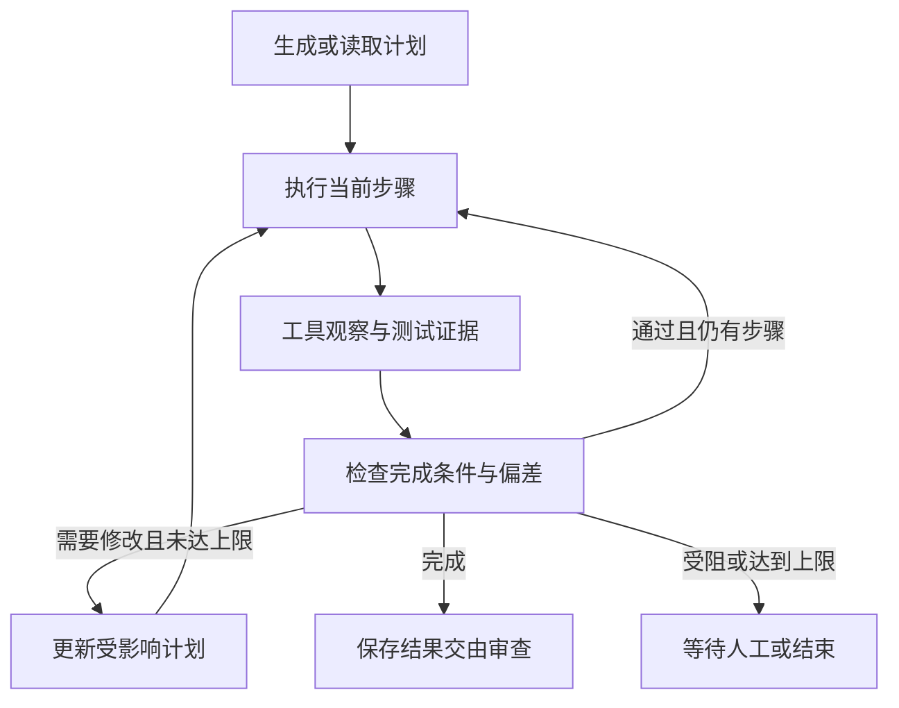

# 规划执行与反思模式

ReAct、Plan-and-Execute 和 Reflection 分别组织决策、计划与反馈。以“订单列表增加创建人筛选”为例，可以比较不同控制方式的质量、成本和故障行为，再决定怎样组合。

## 三种模式分别解决什么问题

| 模式 | 核心过程 | 适合解决的问题 |
| --- | --- | --- |
| ReAct | 判断下一步、执行动作、读取观察，再继续决策 | 实现路径依赖现场信息 |
| Plan-and-Execute | 先形成多步计划，再执行并按需调整 | 任务有多个阶段及明确依赖 |
| Reflection | 根据评价和证据检查结果，再修正方案或输出 | 有可验证标准，需要迭代改进 |

三种模式可以组合，职责划分也不要求部署三个 Agent 或使用三个不同模型。

本方案将这些模式用于 Agent 循环内部。Skill 提供规划方法和检查要点，具体计划由当前任务生成并保存在运行状态中，无需先发布独立业务流程模板。

## ReAct 如何落到工具循环

ReAct 原论文将推理与行动交替组织，让环境观察参与后续决策。工程实现可以保留结构化动作、结果和简短决策说明，无需依赖模型暴露完整内部推理。[ReAct 原论文](https://arxiv.org/abs/2210.03629)

在示例中，Agent 先搜索订单接口，读到实际查询条件后再选择查看数据访问层，随后决定补充参数和页面控件。下一步由新证据决定，适合仓库结构尚不清晰的任务。

每次工具调用仍由 Runtime 校验参数和权限。需要限制重复搜索、重复读取及相同参数的无效调用，防止不断收集材料却没有推进。一次循环包含多个决策步骤，不能把每个步骤都计作 Worker 重试。

## Plan-and-Execute 如何保存计划

这一模式把多步计划生成与具体步骤执行分开，执行结果可以触发后续计划调整。LangChain 官方示例包含规划器、执行器及重新规划过程。[Plan-and-Execute Agents](https://www.langchain.com/blog/planning-agents)

示例计划可以分为确认字段与权限、修改查询接口、增加筛选控件、运行检查、提交审查。每步保存稳定标识、输入输出、依赖、状态和完成标准。已验证结果以引用传给后续步骤，大文件留在工作区或产物服务。

发现字段只存在于关联表时，先记录原假设不成立的证据，再调整查询方案及受影响步骤。只有依赖已满足且写入互不冲突的步骤才并行。计划只是待执行方案，步骤完成需要工具结果支持。

## Reflection 怎样避免自说自话

这里的 Reflection 泛指执行后的检查与修正。可以由规则、测试、人工或模型提供反馈。Anthropic 的 evaluator-optimizer 展示了生成与评价循环，并强调清晰评价标准。[评价与改进模式](https://www.anthropic.com/research/building-effective-agents)

示例中，接口测试发现传入创建人后结果未变化。Agent 在检查环节结合失败用例、实际响应和代码差异，输出问题位置、证据引用及建议修改，再通过工具修复并重新运行对应测试及必要回归。

模型评语与测试证据分开保存。验收条件应预先确定，结合受控测试或独立 CI 结果，避免只靠实现者临时生成的测试自证正确。评价为通过也不能替代业务审查。交付工具仍按目标 Commit 或产物版本检查必需证据，拒绝使用旧版本的通过结果替代当前验证。

## 怎样组合并限制重规划

外层采用计划执行，编码步骤内部使用 ReAct，完成后进行检查。可在示例中设定最多两次重规划，同时限制总时限、调用量和重复失败。具体数值是配置示例，需要通过评测调整。反馈没有新证据、连续修改无进展或权限不足时转人工处理。

局部计划修订保留同一 Run 的 AgentVersion、授权范围上限和总预算，记录计划版本与变更原因，执行前仍检查实时权限。工具或执行片段重试复用既有计划，反思会改变方案或输出，二者均不涉及更新模型参数。已发生的外部写入须核对，不能因计划变化盲目重做。Worker 重启按 Attempt 恢复规则处理。

SDK 内部是否采用某种模式，以公开能力和可见行为为准。平台可以在调用前提供任务目标与 Skill，记录可见计划和工具结果，并在返回后独立校验结果，不应声称控制不可见的内部反思。

## 面试自测

1. 搜索代码的场景为何适合 ReAct，代价是什么？
2. 计划步骤需要哪些字段才能恢复和核查？
3. 一次网络重试与一次反思修正有什么区别？
4. 哪些证据能推翻模型给出的“通过”结论？
5. 重规划怎样保留预算、版本和副作用边界？
6. 三种模式如何组合，怎样证明组合值得增加成本？

[返回执行层](../README.md) · [回看 Agent 执行循环](../11-loop-control/01-Agent本体与执行循环.md) · [知识点清单](../../README.md)
