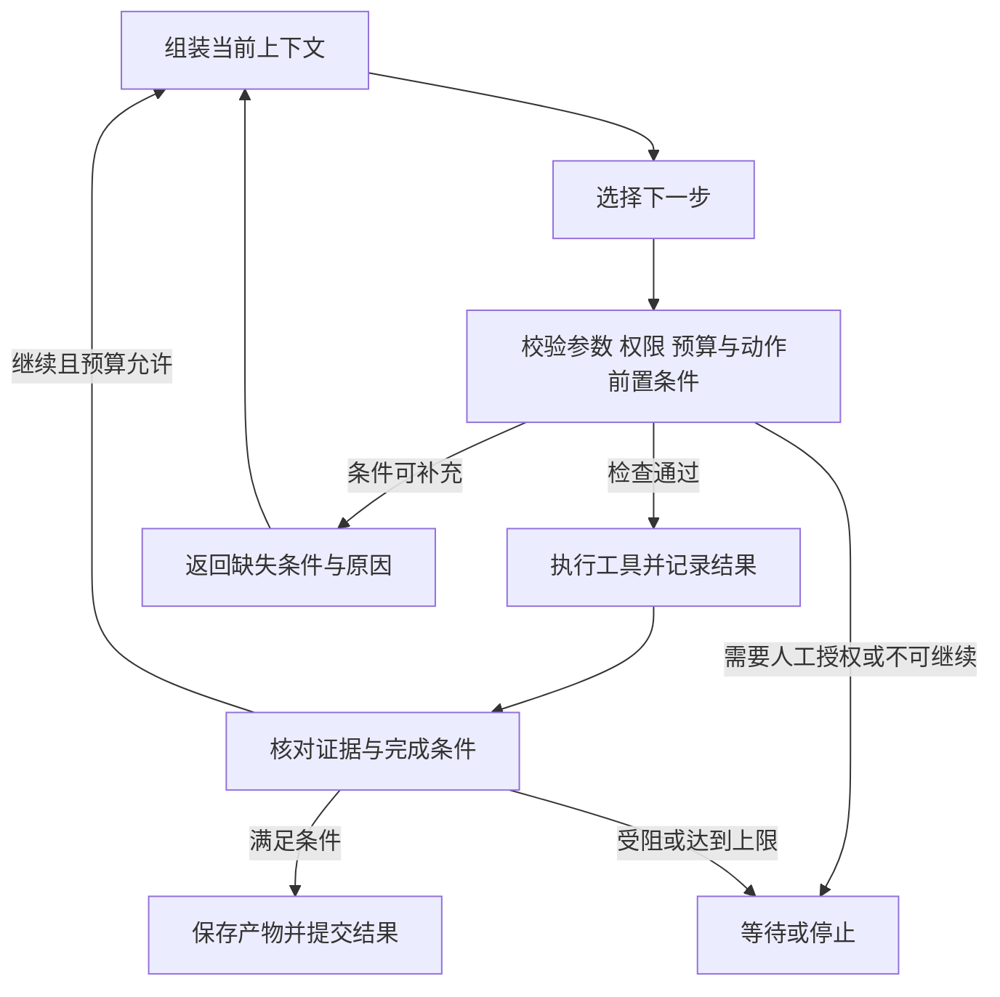

# Agent 本体与执行循环

Agent 执行循环把用户目标转化为可校验的动作，再依据工具与测试反馈决定下一步。以“订单列表增加创建人筛选”为例，需要同时明确行为逻辑、运行状态和完成条件。

## 本体与 Runtime 各负责什么

本 JD 中的“本体”指 Agent 自身的规划、决策、执行与反馈逻辑，与知识建模中的 Ontology 含义不同。它根据目标和当前证据选择下一步，判断继续、调整、等待还是结束。

| 部分 | 主要职责 | 示例 |
| --- | --- | --- |
| 行为逻辑 | 理解目标、形成计划、选择动作、检查结果 | 先查接口参数，再决定修改哪些文件 |
| Runtime | 推进循环、保存状态、调用工具、限制预算、处理中断 | 执行查询、保存结果、恢复未完成任务 |
| 平台治理 | 固定配置、计算权限、管理环境与审计 | 限定仓库范围，校验推送审批 |

这些职责可以在同一进程实现，但接口应分清。模型提出调用不代表已经执行，动作仍需经过参数校验、实时授权和环境约束。

## Agent Runtime 与 Skill 的职责

本方案由 Agent Runtime 直接启动任务循环。Skill 提供实现方法和检查步骤，Agent 根据目标与反馈选择加载哪些方法、调用哪些工具。Runtime 保存状态、限制预算、处理中断，工具服务落实实际动作的授权和业务前置条件。

示例中的 Agent 可以加载筛选功能实现 Skill，搜索代码、定位查询链路、修改文件并根据测试结果调整方案。需要时生成当前任务计划，步骤可以改变，允许工具、文件范围和完成条件保持约束。

LangGraph 可以承载动态 Agent 循环，内部图用于实现模型调用、工具反馈和恢复。本基座不要求额外配置业务 Workflow 模板。官方文档分别说明了预定义工作流和动态 Agent 的特征。[工作流与 Agent](https://docs.langchain.com/oss/python/langgraph/workflows-agents)

## 一次循环保存哪些状态

Run 固定 AgentVersion 和原始输入。一次 Worker 尝试对应 Attempt，模型多走一轮不会自动产生新 Attempt。中断恢复沿用原 Run，重新分配 Worker 接续执行时建立新的 Attempt。版本或 Runtime 需要更换时创建关联的新 Run。

建议将循环状态分为五组。

- 目标与验收条件，保存需求范围、仓库基线和预先确认的检查项。
- 进度与按需的计划，保存已完成事项；复杂任务采用显式计划时，再保存步骤标识、依赖、状态和结果引用。
- 动作与观察，保存工具参数、操作 ID、结果引用和错误类别。
- 运行约束，保存剩余预算、截止时间、循环次数和等待原因。
- 证据与产物，关联文件版本、测试报告、工作区及未决外部操作。

可信身份和策略引用由服务端注入。模型不能修改租户、权限或预算上限。结构化计划、工具请求与反馈足以支撑排障，运行正确性不依赖获取模型隐藏推理。

图中是正常推进路径。工具超时还需区分明确失败与结果不确定，后者先查询实际结果，避免重复写入。

## 用同一需求验证闭环

先确认创建人字段、筛选方式与权限范围，再读取接口和页面实现。修改后运行预先确定的验收检查，覆盖筛选生效、清空恢复及原有分页行为。模型输出“已完成”只是候选结论，是否通过由测试结果和审查证据判断。

请求交付时，业务服务按动作要求核对当前 Commit 或产物摘要对应的测试、审查与审批记录。检查未完成或结果对应旧版本时拒绝动作，Agent 再根据原因补充执行。Skill 文本提供指导，不能替代这类强制检查。

每轮检查完成条件、总时限、调用额度和重复动作。达到上限、权限撤销或收到取消时停止新增动作，按 Runtime 状态机等待或退出。完成与停止请求并发时通过条件更新提交状态。必要产物持久化后才能提交成功终态，业务验收和发布状态由对应应用管理。

这种基于环境反馈并设置停止条件的循环，也是 Anthropic 官方总结的 Agent 实现方式。[Building effective agents](https://www.anthropic.com/research/building-effective-agents)

## 容易混淆的边界

LangGraph 路径可自行实现循环内部的节点和路由，这些属于框架实现细节。Codex SDK 的内部循环由其 Harness 管理，适配器只控制开放的输入、事件和生命周期接口，不能假定能插入每个内部步骤。恢复还依赖工作区与外部操作记录，checkpoint 本身不能撤销已完成的写入。

## 面试自测

1. Agent 行为逻辑、Runtime 与平台治理如何分工？
2. Skill 中的方法步骤与 Runtime、业务工具的强制检查有什么区别？
3. 一轮模型调用、一个 Run 和一次 Attempt 有何区别？
4. 模型说任务完成后，还需要哪些验收证据？
5. 重复动作、工具超时和用户取消分别怎样退出循环？
6. 自定义图与 SDK Harness 的控制边界有什么差异？

[返回任务执行](../README.md) · [返回执行层](../../README.md) · [继续阅读规划与反思](../01-task-planning/01-规划执行与反思模式.md) · [知识点清单](../../../README.md)
