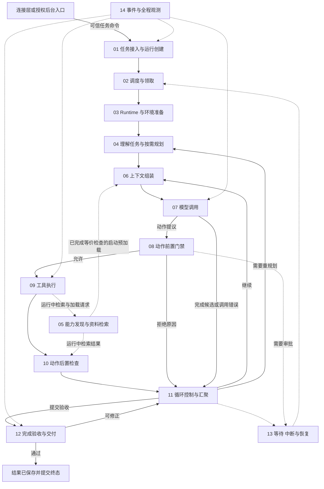

# Agent 基座执行层设计

执行层接收可信任务命令，把已发布的 AgentVersion 转化为可调度、可中断、可恢复的 Agent 循环，覆盖 Run 创建、上下文组装、Skill 装载、工具调用、Runtime 适配、Worker 和结果回收。[连接模块](../02-connection/README.md) 负责外部接入、参数规范化、Session 归属与历史订阅；管理层保存配置与策略，记忆服务管理记忆数据，公共组件提供模型、工具、存储和观测能力。

本目录按 **14 个职责环节** 拆解执行层：01—03 负责启动，04—11 构成可反复进入的 Agent 循环，12 负责完成交付，13 处理等待与异常恢复，14 贯穿全程。这是本平台的学习与设计划分，各环节可以在同一进程或同一次模型调用中协同完成，不要求每项任务顺序执行 14 步。

参考资料核对于 **2026 年 11 月 15 日**，包括 Codex 官方文档，以及 Pi、DeepSeek Harness 的固定源码提交。公开机制、接入限制和本平台补充的职责分别记录在 [参考实现与设计边界](./参考实现与设计边界.md)。这些当前资料不用于推定 2026 年 7 月的实际交付范围。

## 环节目录

| 编号与环节 | 何时进入 | 本环节主要交付 | 职责边界 |
| --- | --- | --- | --- |
| [01 任务接入与运行创建](./01-request-entry/README.md) | 可信新任务命令到达 | 原始接收回执、Run、配置快照和调度事件 | 复核资格与幂等创建；连接协议归连接层 |
| [02 调度与 Worker 领取](./02-scheduling/README.md) | 新任务、重试或恢复需要执行资源 | Session 任务执行资格、有效 Attempt 与租约 | 管谁在执行；连接路由独立处理 |
| [03 Runtime 与环境准备](./03-runtime-setup/README.md) | Worker 取得执行权 | 就绪的 Runtime、会话、工作区和工具入口 | 校验与准备运行条件；不等于把所有资源装入上下文 |
| [04 任务理解与动态计划](./04-intent-planning/README.md) | 开始任务、目标变化或需要重规划 | 目标、待澄清项、方法选择与当前计划 | 可以与模型决策合并；不是必经的独立分类请求 |
| [05 能力发现与资料检索](./05-capability-retrieval/README.md) | 需要方法、工具或证据 | 授权候选与所需的版本化内容 | 搜索、加载、使用分开；不自动扩大权限 |
| [06 上下文组装与预算检查](./06-context-assembly/README.md) | 每次模型请求前或需要压缩时 | 有来源、满足预算的模型输入 | 管本轮可见内容；不取代持久化状态 |
| [07 模型调用](./07-model-invocation/README.md) | 输入和调用条件就绪 | 完整动作提议、完成候选或明确错误 | 处理流式协议与响应；不直接执行提议 |
| [08 动作前置门禁](./08-pre-action-gate/README.md) | 每个动作实际执行前 | 允许、拒绝或待审批的动作 | 检查参数、实时权限和业务前置条件 |
| [09 工具执行](./09-tool-execution/README.md) | 动作获准后 | 实际执行结果、任务句柄或结果未知状态 | 负责 I/O、副作用和操作记录；调用成功不等于任务完成 |
| [10 动作后置检查](./10-post-action-check/README.md) | 工具返回、异常或后台结果到达 | 校验后的观察、证据与错误分类 | 不可信结果受控入上下文；不能撤销已有副作用 |
| [11 循环控制与任务汇聚](./11-loop-control/README.md) | 新观察、计划更新或完成候选到达 | 继续、重规划、等待、停止或提交验收的决定 | 限制重复动作与预算，管理子任务；不凭模型自述判成功 |
| [12 完成验收与交付](./12-completion-delivery/README.md) | 得到完成候选或进入收尾 | 持久化结果、终态、通知和资源回收记录 | 检查实际目标与证据；外部发布仍走动作门禁 |
| [13 等待、中断与恢复](./13-wait-recovery/README.md) | 缺少输入、审批、异常、取消或执行恢复 | 等待记录、恢复点、核对结果和停止状态 | 页面重连归连接层；执行恢复不代表外部操作可重做 |
| [14 事件记录与全程观测](./14-observability/README.md) | 各环节发生状态或动作变化 | 持久状态、必要事件、审计与评测依据 | 贯穿全程；连接层负责订阅、同步与推送 |

每个目录的 `README.md` 都说明触发时机、输入输出、基本步骤、上下游、故障边界和面试追问，可在对应目录继续扩展接口、数据模型与典型问题。

### 通用运行契约

- [运行对象与可信上下文](#运行对象与可信上下文)
- [一次运行的执行链路](#一次运行的执行链路)
- [上下文组装](#上下文组装)
- [Agent 循环与 Runtime 适配](#agent-循环与-runtime-适配)
- [Run 状态与调度所有权](#run-状态与调度所有权)
- [外部副作用与恢复](#外部副作用与恢复)
- [等待、超时和取消](#等待超时和取消)
- [事件、工作区与产物](#事件工作区与产物)
- [Agent 本体与执行循环](./11-loop-control/01-Agent本体与执行循环.md)
- [规划执行与反思模式](./04-intent-planning/01-规划执行与反思模式.md)
- [多 Agent 协作与结果汇聚](./11-loop-control/02-多Agent协作与结果汇聚.md)
- [组件协作与故障处理](./13-wait-recovery/01-组件协作与故障处理.md)

## 运行对象与可信上下文

| 对象 | 统一含义 | 生命周期要求 |
| --- | --- | --- |
| AgentVersion | 不可变的发布版本 | 固定 Prompt、Skill、工具、Runtime 配置和依赖引用 |
| Session | 连续交互的会话 | 连接模块定义归属与访问规则；执行层关联 Run 和执行器会话 |
| Run | 一次逻辑调用 | 固定 `agent_version_id`、输入和执行策略引用 |
| Attempt | 一次 Worker 执行尝试 | 分配工作区、租约和执行所有权令牌 |
| external_ref | 上层业务关联 | 关联需求 Task、工单等业务对象 |

一次 Run 可以经历多个 Attempt。等待人工输入后继续原调用，仍归属原 Run。新的独立任务创建新 Run，同 Session 默认串行执行；补充输入、审批和取消作为原 Run 的控制命令及时处理。Session 规则由会话模块定义，执行层在一份权威状态中原子取得与释放任务执行资格，连接层不另设执行锁。并行子任务使用独立执行上下文。

客户端通过 `agent_id` 提交任务，连接层完成外部参数规范化并交付可信命令，授权后台任务也遵循同一契约。执行层先复核身份与资源访问，按租户调用作用域检查幂等键：相同载荷且可访问原 Run 时返回原 Run 和原 ack，不重新解析新版或扣占额度；不同载荷返回冲突。仅新任务解析发布版本并保存配置快照，Worker 通过 `run_id` 获取；重试和执行恢复不重选配置。当前权限与停用状态在实际执行时另行校验。详见 [Agent 配置发布与运行快照](../01-management/03-Agent配置发布与运行快照.md)。

执行上下文由服务端建立，携带 `tenant_id`、`workspace_id`、`subject`、`agent_version_id`、`session_id`、`run_id`、`attempt_id`、`trace_id` 和策略引用。执行层验证可信入口与身份来源，客户端正文和模型输入不能覆盖这些字段。配置版本固定，实际资源访问仍需检查权限撤销与策略有效性。

## 一次运行的执行链路

图中实线表示主要执行交接，虚线表示资源供给或贯穿能力，不是需要租户配置的业务 Workflow。05 可由入口预选，也可由模型提出检索或加载请求后经 08—10 执行，预加载也执行等价的访问与结果检查；普通任务可跳过 Skill、召回或工具调用。13 可从任一发生异常或等待的环节进入，14 记录所有环节，图中仅画部分关联。

门禁分别落在任务接入、模型请求前、动作前、动作结果返回后和最终交付处。连接层建立身份并规范化命令，任务接入复核可信身份、资源范围和任务资格；模型前检查来源、材料与预算；动作前落实实时权限和业务条件；动作后验证返回事实并约束内容；最终验收检查交付是否满足目标。后置检查不能代替执行前拦截。

幂等未命中的新任务才校验当前发布版本、输入与预算，在同一提交边界保存幂等记录、Run、快照引用、额度预占、原 ack 和 outbox 事件，再异步送入队列。唯一约束处理并发重试，避免重复扣占。调度原子确认 Session 任务执行资格并领取 Worker 所有权、创建 Attempt，准备环境后按固定配置启动 Agent 循环。结束时先保存结果与必要产物，再提交终态、释放资格并发布通知。

队列负责传递待执行信号，数据库保存运行状态。重复投递通过条件领取与状态校验处理。Worker 调度与连接路由分开，客户端连接到哪个网关不决定由哪个 Worker 执行。需求应用继续维护需求、审查和交付等业务状态，相关服务校验具体动作的执行条件。

## 上下文组装

Context Assembler 读取 AgentVersion 中的上下文策略，并按可信身份调用记忆和知识服务。它组织当前输入、会话工作状态、相关历史经历、事实知识、已发布操作方法及工具定义，记录来源、版本和裁剪情况。

组装时先执行访问过滤，再按相关性和 token 预算选择内容，给当前任务、工具结果和最终输出预留空间。大型工具结果转为摘要与产物引用。来自文档、记忆和工具的内容保留来源标签及指令优先级，权限判断由服务端执行。

自定义 LangGraph 循环可以在每轮模型请求前重新组装上下文。Codex 由自身 Harness 管理内部上下文，适配层负责初始输入、授权工具、Skill 和资料引用，并接收可用的运行事件。各执行器的内部状态分别持久化。

渐进式发现、资源装载、上下文预算与裁剪在 [上下文管理模块](../04-context/README.md) 中展开。

## Agent 循环与 Runtime 适配

执行入口直接启动 Agent 循环，读取固定版本的 Prompt、可用 Skill 与工具、运行预算和完成条件。Skill 提供可复用的方法、判断依据与检查步骤，Agent 根据任务和反馈选择下一步。任务需要计划时，由循环生成并维护当前计划。

每轮执行模型调用、Skill 选择或工具提议、参数校验、授权审批、实际调用和结果反馈。Runtime 检查预算、状态与停止条件，将异常转换为明确错误交给后续决策。结构化结果通过 schema 与语义校验后才能被接受，模型提出完成时还需核对预先确定的输出条件及证据。

| 运行能力 | 执行规则 |
| --- | --- |
| 动作选择 | 根据目标、Skill 与已保存的结果选择下一步，调用前落实服务端检查 |
| 并行与汇聚 | 仅并行可独立执行的工具动作或子任务，约定必需结果、失败处理及结果合并规则 |
| 人工等待 | 保存等待原因、审批动作、参数摘要、授权范围与恢复点 |
| 子任务 | 创建子 Run，固定目标 AgentVersion，继承并收窄权限和预算，记录父子关联 |

LangGraph 可用内部图和节点实现 Agent 循环，复用持久化与中断机制。图属于 Runtime 的实现方式，本方案不另外提供业务 Workflow DSL 或流程模板产品。人工恢复可能重新执行所在框架节点，外部写入应具备幂等保护。[LangGraph 持久化文档](https://docs.langchain.com/oss/python/langgraph/persistence) · [人工中断文档](https://docs.langchain.com/oss/python/langgraph/interrupts)

Codex 执行器通过 SDK 复用成熟 Harness，承担代码分析、文件操作与工具执行。需要更细的审批、事件和生命周期控制时，可以实现 App Server 适配。部署时固定 SDK 与运行时版本，提供工作区及会话持久化安排。[Codex SDK](https://learn.chatgpt.com/docs/codex-sdk) · [Codex App Server](https://learn.chatgpt.com/docs/app-server)

适配器对外提供 `start`、`stream`、`cancel`、`resume` 和结果查询，并声明恢复、持久化等待、工具注入、模型选择等能力。发布和调度时校验所需能力，不支持的组合返回明确错误。切换 Runtime 时创建采用相应配置的新 Run 和执行上下文，显式选择可传递的输入与产物，并关联原 Run。模型或供应商变更也按后端支持方式处理，保留原会话和版本记录。

这些职责在自研循环中可以由平台直接实现；接入 SDK 时，只能在公开的调用、hook、事件与工具边界介入。无法插入的内部环节通过受控资源服务、运行环境和返回后验收补齐可实施的约束，不能宣称所有 Runtime 都支持逐步骤替换。Codex、Pi 与 DeepSeek Harness 的实际差异见 [参考实现与设计边界](./参考实现与设计边界.md)。

### 关键业务动作的硬前置检查

Skill 中的“测试通过后交付”是方法指导，交付工具和业务服务还需核验实际条件。研发任务请求交付或发布时，服务按动作契约检查目标仓库、Commit 或产物摘要，以及对应版本的测试、审查与审批记录。缺少必需证据、证据对应旧版本或条件未满足时，直接拒绝动作并返回原因。

生成新补丁或产物后，旧结果不能直接证明新版本已经通过检查。Run 的输出校验、业务动作的前置检查和最终业务验收各自保留结果，不以模型完成声明替代。动态选择执行步骤也不会改变这些强制条件。

## Run 状态与调度所有权

Run 的主路径为 `QUEUED → RUNNING → SUCCEEDED`。需要输入时进入 `WAITING_INPUT`，也可表示为 `WAITING` 加 input 原因；审批等等待用对应原因区分。可重试故障进入 `RETRY_WAIT`，需要重新分配资源时再入队。不可恢复故障进入 `FAILED`。取消与超时先进入 `CANCELLING`，完成停止确认后分别进入 `CANCELLED` 或 `TIMED_OUT`。

每次领取以条件更新取得租约，生成递增的 fencing token。心跳续租、状态更新和产物提交都校验当前 Attempt 与 token。旧 Worker 租约失效后可能仍在运行，调度器需要终止或隔离旧实例，受控工具服务拒绝旧 token 的新写入。

Session 的任务执行资格与 Worker 租约是两项状态：执行层按会话规则在统一权威记录中原子持有和释放资格，避免两个独立 Run 同时改写同一 Runtime 会话。原 Run 等待输入或释放 Worker 后仍持有资格；Worker 租约失效也不直接放行下一任务，应先接管或结束原 Run。终态与资格释放用一致的状态版本控制，连接层读取并路由，不另维护执行锁。并行工具调用和子任务使用独立结果区，汇聚时按约定提交。

重试按错误分类执行。短暂网络错误可以退避重试，输入错误返回调用方，授权失败等待重新授权。模型调用、工具和 Worker 的重试共用上限与截止时间，防止多层重试放大成本。单轮调用重试可留在当前 Attempt，重新分配 Worker 接续执行时创建新 Attempt。

队列按租户配额、优先级和入队时间调度，限制排队长度与并行 Attempt 数。子任务预留的预算计入父 Run 总额，实际模型与工具用量回收后更新余额。预算耗尽时停止新增调用，并保存已经产生的结果。

## 外部副作用与恢复

checkpoint 保存的是执行状态。工具已经完成写入但确认响应丢失时，恢复过程需要查询外部结果。LangGraph 官方也明确要求对节点重试中的副作用设置幂等与结果核对机制。[LangGraph 故障恢复文档](https://docs.langchain.com/oss/python/langgraph/fault-tolerance#retry-boundaries-and-idempotency)

写操作先持久化操作意图、稳定操作 ID、参数摘要和目标资源，再调用外部服务。操作 ID 跨 Attempt 保持一致。外部支持幂等键时直接使用，否则结合业务唯一约束、受控串行化和结果查询。

例如创建 MR 超时后，将操作标记为结果待核对，查询目标仓库的分支、任务标识及 MR。匹配成功则补写结果，确认未执行后重试，持续不确定则转人工处理。fencing 可以拒绝过期实例后续发起的写入，已经发出的请求仍需对账。

恢复前核对 AgentVersion、Runtime 版本、checkpoint/session 数据、工作区版本、产物清单和未决操作。重新分配 Worker 恢复时创建新 Attempt 接续原 Run。恢复数据不兼容时，只有具备可验证的已提交执行边界、完整输入与工作区材料，并完成副作用核对，才允许按原固定配置重新执行未完成部分。条件不足则明确失败或转人工处理，保留原因。需要更换 AgentVersion 或 Runtime 的重建创建关联的新 Run。

## 等待、超时和取消

支持持久化暂停的执行器在保存恢复点后可以释放 Worker，原 Run 仍保留 Session 任务执行资格。补充输入、审批与取消走原 Run 的控制通道，不能排在等待它结束的独立任务队列里。审批结果绑定具体动作、参数及授权范围，恢复时重新校验。依赖活动进程的审批采用有期限的在线等待，跨进程恢复以执行器实际支持的能力为限。

页面刷新、网络断开或 WebSocket 关闭不自动取消 Run，也不创建 Attempt 或恢复 checkpoint。连接层重连后同步已有运行状态；执行进程失效需要接管时才走故障恢复，持久化暂停后重新分配 Worker 则按原 Run 的恢复契约继续。显式取消仍须经过授权控制接口。

任务记录总截止时间、单步时限、工具超时和预算。取消意图先持久化，随后停止新的模型调用、工具动作和子任务派发，并向 Runtime、子进程及子任务发送停止请求。无法确认停止时保留取消中状态及异常原因。已发生的外部操作继续记录和核对。

完成与取消并发到达时，通过状态版本条件更新确定先被接受的转换。终态保留唯一结果，较晚的请求记录为事件，防止已经成功的 Run 被迟到的取消或旧 Attempt 回调覆盖。

## 事件、工作区与产物

执行层事务性保存权威状态与必要事件，并通过异步机制发布；事件带 `run_id`、`attempt_id`、序号、类型和时间。连接层负责历史访问、订阅、同步与推送，默认以一致快照及同一投影的状态版本恢复当前视图，有缺口时重新查询。需要完整回放时，再提供持久事件与快照覆盖水位，按留存范围补取历史。状态版本和事件序号不能随意混比，详见 [断线重连与状态恢复](../02-connection/03-断线重连与状态恢复.md)。瞬时 token 流可以合并或不持久化，Run 终态、必要操作及恢复材料不能因此缺失。

checkpoint/session 用于运行恢复，artifact 用于保存输入输出文件、代码补丁、报告和测试记录。每项产物保存归属、内容摘要、来源 Attempt、生成版本与存储引用。成功终态提交前确认必要产物已持久化，临时环境在归档后清理。

Worker 使用独立工作区、受限身份、资源额度和网络策略。工具网关控制企业接口访问，原生 Shell 与文件工具还受执行环境限制。凭证按任务范围注入，生产写入和 Git 交付动作通过受控服务完成。环境策略覆盖原生工具直接访问外部资源的路径。

## 面试时讲清的五个问题

1. Run 表示哪次逻辑调用，哪些重试会生成新的 Attempt？
2. Agent、Skill、Runtime 与业务工具分别决定或检查什么？
3. 两种 Runtime 如何协商能力，恢复数据分别存在哪里？
4. 旧 Worker 未停止、外部请求结果不确定时怎样处理？
5. 页面重连、人工等待和任务取消如何保持状态一致？

## 模块协作与后续细化

运行由 [连接模块](../02-connection/README.md) 或授权后台入口交付可信命令，依赖 [管理层](../01-management/README.md) 的配置与授权，调用 [模型模块](../06-models/README.md)、[MCP 工具](../07-mcp/README.md) 和 [记忆服务](../05-memory/README.md)，通过 [沙箱](../10-sandbox/README.md) 与 [产物服务](../11-artifacts/README.md) 保存恢复条件和结果。执行层产生权威状态与事件，连接层负责订阅与客户端同步。跨模块故障见 [组件协作与故障处理](./13-wait-recovery/01-组件协作与故障处理.md)。

后续按以下专题细化。

- Session、Run、Attempt、事件与操作记录的数据模型和接口。
- 调度、租约、fencing、并行汇聚和子任务预算。
- LangGraph 与 SDK 的适配接口及能力矩阵。
- 执行中断、恢复、取消、外部操作对账与连接层状态同步契约。

## 对应案例

[查看 03-execution 案例](../../case/03-execution/README.md)。

- [Skill 激活集合与工具授权](../../case/03-execution/01-Skill激活集合与工具授权.md)

[返回知识清单](../README.md)
