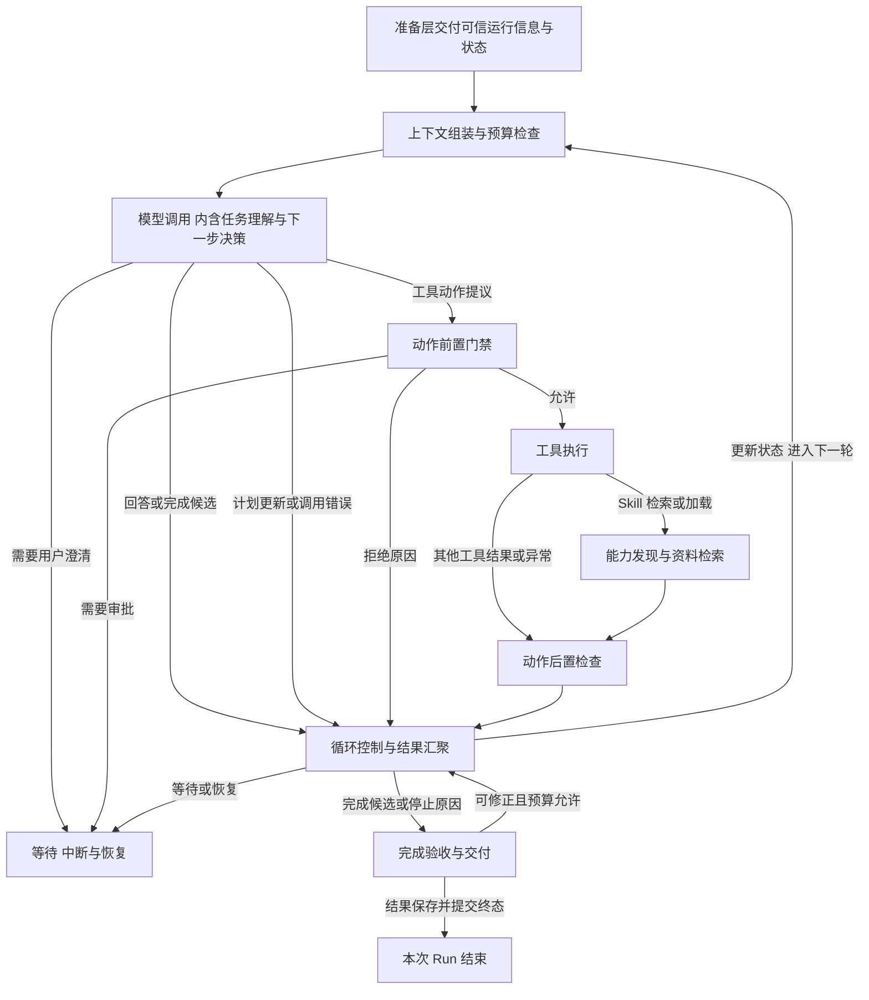

# Agent 执行循环总览

Agent 循环承接 [Runtime 基础初始化](../03-preparation/03-runtime-setup/README.md)，在原 Run 与当前 Attempt 中反复完成模型决策、受控动作和结果反馈，直到形成可验收的结果、需要等待，或无法继续。输入是固定配置、可信身份、当前任务与运行状态，输出是完成候选、等待事项或停止原因。

与 [执行准备](../03-preparation/README.md) 的分工是：准备阶段建立当前执行尝试的运行实例，交付可信运行信息与状态；这里统一负责首轮、后续轮次和恢复后的模型输入组装，再调用模型和执行工具。准备层不另写一份初始化 Prompt。进入下一轮不重新创建 Run 或初始化 Runtime，每轮仍复核当前执行条件、权限和预算。

**每轮先组装上下文，再调用模型完成任务理解、规划和下一步决策。** 首轮用基础指令、当前请求、必要历史和能力入口即可开始，不额外增加意图分类或前置规划调用。复杂任务按需维护计划，简单任务可以直接回答或调用工具。具体 Skill 正文、知识内容和执行环境按任务需要准备。

执行目录中的 01—08 划分八项循环职责，与 09 完成交付、10 等待恢复、11 全程观测处于同一级知识目录。编号用于组织知识点，不代表固定执行顺序或八次模型调用。任务规划描述模型决定什么，模型调用处理请求与响应，循环控制根据实际状态和预算决定是否允许继续。

## 内部知识点

| 循环职责 | 解决的问题 | 主要边界 |
| --- | --- | --- |
| [01 上下文组装与预算检查](./01-context-assembly/README.md) | 本轮模型实际看到什么 | 首轮、后续与恢复共用同一逻辑，不代替运行状态持久化 |
| [02 模型调用](./02-model-invocation/README.md) | 如何取得完整响应与动作提议 | 处理调用和流式协议，本次调用内完成下一步决策 |
| [03 任务理解与规划](./03-task-planning/README.md) | 目标是什么，下一步做什么，是否需要计划 | 解释模型调用中的决策职责，不是后置的第二次调用 |
| [04 能力发现与资料检索](./04-capability-retrieval/README.md) | 需要哪些 Skill、工具或业务证据 | 按需发生，候选发现、正文加载与实际执行分开 |
| [动作前置门禁](./05-pre-action-gate/README.md) | 动作现在是否允许执行 | 校验参数、当前授权、审批和业务前置条件 |
| [工具执行](./06-tool-execution/README.md) | 如何完成实际 I/O 与业务动作 | 保存操作记录，区分失败与结果未知 |
| [动作后置检查](./07-post-action-check/README.md) | 返回了什么，哪些内容可以进入下一轮 | 校验结构、大小与证据，不能撤销既有副作用 |
| [循环控制与任务汇聚](./08-loop-control/README.md) | 继续、调整、等待还是提交验收 | 管理进展、共享预算与子任务，不凭自述判成功 |

## 实际怎样循环

图中的首轮入口与循环回路进入同一个上下文组装器。它复用固定配置，结合最新状态生成本轮输入；跨 Worker 恢复完成后也回到这里，不原样重放旧 Prompt 或工具写入。完成交付和等待恢复按当前状态进入，全程观测贯穿各个环节，并非等到最后才记录。Skill 检索和加载也是工具动作，经过前置门禁、实际调用和后置检查后，内容才进入后续上下文。加载 Skill 不等于执行其脚本，也不授予额外工具权限。已有明确需求的预加载可以先准备必要资料，但须完成等价的访问与结果检查。

普通问答可以从模型回答直接进入验收，不使用 Skill、检索或业务工具。复杂任务会多次返回上下文与模型决策，每轮可以更新近期计划。模型选择下一步，服务端控制实际允许执行的范围。

例如“订单列表增加创建人筛选”，首轮可以直接提出查看相关代码或检索研发 Skill。取得材料后决定修改位置，调用工具完成修改，再读取测试结果。测试失败时把错误和当前代码版本带入下一轮，决定修正方案。不会先固定经过“分类模型、规划模型、执行模型”三个独立请求。

## 循环中必须保持的约束

1. **身份、版本与执行权。** 始终沿用原 Run 配置快照和当前 Attempt 的有效租约。配置固定不代表权限固定，每次资源访问和实际动作仍检查当前授权，失去执行权后停止新增派发。
2. **参数、审批与业务条件。** 模型提出的是待执行动作。改动参数后重新校验，审批须匹配当前动作与参数。交付代码或产物时，服务端检查同一 Commit 或内容摘要对应的测试、审查及必要审批，Skill 中写有这些步骤不能代替证据。
3. **反馈与副作用。** 工具返回内容按不可信数据处理，明确区分成功、失败和结果未知。未知写入先对账，重试沿用稳定操作标识。更改计划不能撤销已发生的外部动作。
4. **预算与进展。** 模型调用、工具重试和子任务共享剩余费用、次数及截止时间。重复动作没有新证据时限制修复和重规划，不能通过放宽验收条件结束循环。
5. **完成与终态。** 模型停止调用工具只产生完成候选。由 [完成验收与交付](./09-completion-delivery/README.md) 检查目标与版本证据，保存结果和必要产物后提交终态，再回收资源。停止原因可能是成功、失败、取消或超时。

## 状态与恢复如何衔接

正常循环处于 `RUNNING`。需要用户输入或审批时，由 [等待、中断与恢复](./10-wait-recovery/README.md) 保存等待事项及恢复条件。原 Runtime 仍可用且持有执行权时，补充输入和局部模型、工具重试继续原 Attempt，不重新创建任务。

跨 Worker 接续先判断恢复条件，再由 [执行准入与归属管理](../03-preparation/02-scheduling/README.md) 取得容量和新执行权，经 [Runtime 初始化](../03-preparation/03-runtime-setup/README.md#重试与上下文恢复的分工) 恢复必要运行状态，回到本循环组装下一轮输入。沿用原 Run 快照、Session 资格、预算和截止时间，按需恢复实际依赖的工作区及资料。无资源时保留 `RECOVERY_PENDING` 等明确状态，不重建新任务，也不盲目重放已发生的操作。

各环节的状态、动作、用量和必要证据交给 [事件记录与全程观测](./11-observability/README.md)。页面断线仅影响连接和展示，不自动取消循环或触发 Worker 接管。

以上是平台职责划分。自研循环可以直接实施，接入成熟 SDK 时按公开的接口、事件和扩展点适配，不能据此宣称可接管 SDK 内部每次决策和上下文处理，详见 [参考实现与设计边界](./参考实现与设计边界.md)。

## 面试追问

1. 任务规划与模型调用为什么分目录，却不需要分成两次请求？
2. 模型提出加载 Skill 后，内容经过哪些检查才会被下一轮使用？
3. 工具返回成功、模型认为完成和 Run 成功分别依赖什么证据？
4. 局部重试、跨 Worker 接续和新建 Run 分别在什么情况下发生？

[返回执行层总览](./README.md)
