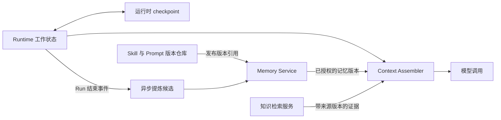

# 四层记忆服务设计草案

本稿将记忆按工作、情景、语义、程序性四类组织，用于设计小型 Agent 基座和练习面试表达，实施状态待实际项目核实。CoALA 提出工作记忆与三类长期记忆的概念框架。本方案采用这一工程划分，具体数据结构、授权和发布流程由业务需求确定。[CoALA 原论文第 4.1 节](https://arxiv.org/html/2309.02427v3#S4.SS1)

## 细知识点目录

- [对象与职责](#对象与职责)
- [四类记忆如何使用](#四类记忆如何使用)
- [作用域与检索](#作用域与检索)
- [字段与服务接口草案](#字段与服务接口草案)
- [写入与并发处理](#写入与并发处理)
- [撤销与污染控制](#撤销与污染控制)

## 对象与职责

短期与长期记忆按时间和使用范围描述，工作、情景、语义、程序性记忆按职责划分。两种分类需要结合实际数据生命周期解释。

`AgentVersion` 是不可变的 Agent 配置版本。一个 `Session` 包含多个 `Run`，一个 `Run` 表示一次逻辑执行，重试生成多个 `Attempt`。每个 Run 固定 AgentVersion，记忆来源记录到具体 Run、Attempt 和事件范围，防止把失败尝试混入最终结论。

Runtime 持有当前任务状态，使用自身 checkpoint 持久化可恢复部分。Memory Service 管理情景、语义和程序性记忆的候选、发布、查询、失效与删除。执行层的 Context Assembler 为平台可控的模型调用选择材料、压缩并分配 token 预算。SDK 执行器按其暴露的输入和会话接口接入。LangGraph 的 checkpointer 保存线程状态，Store 保存跨线程数据，可承接这两种持久化职责。[LangGraph 持久化文档](https://docs.langchain.com/oss/python/langgraph/persistence)

以下存储、接口和一致性规则是面向本基座的工程设计推导。

## 四类记忆如何使用

| 类型 | 内容与例子 | 读写触发 | 存储与生命周期 |
| --- | --- | --- | --- |
| 工作记忆 | 当前目标、约束、待办、最近工具结果、已选证据。例为正在修改的订单筛选需求及失败测试 | 每步执行读取，用户输入和工具结果更新 | Runtime 状态与已有 checkpoint，大文件存产物引用，按会话恢复与保留策略清理 |
| 情景记忆 | 某次任务的背景、操作摘要、结果、失败原因与验证证据。例为某仓库增加筛选条件时遗漏分页测试 | 遇到相似任务时读取，Run 结束后提炼候选 | 关系库保存结构化摘要，明细引用事件和产物，发布后保留历史版本，过期归档或删除 |
| 语义记忆 | 有适用范围的事实、偏好和约定。例为用户确认的报告语言偏好、项目负责人确认的分页约定 | 任务开始或缺少事实时读取，明确确认或可靠证据支持时新增和修订 | 关系库按实体与事实键保存版本，语义索引辅助召回，设置有效期并允许更正、撤销 |
| 程序性记忆 | 可复用的方法、检查步骤和操作规范。例为新增筛选条件的实现与验证 Skill | AgentVersion 装载或能力选择时读取，经评测及发布规则通过后更新 | 正文复用 Skill/Prompt 版本仓库，记忆服务保存引用、适用条件与评测记录，停用和回滚通过版本管理 |

情景、语义和程序性记忆分别对应经验、事实与行为指令。LangGraph 文档也讨论了任务执行中写入与后台提炼两种方式，本稿默认在后台提炼长期记忆。[LangGraph 记忆概览](https://docs.langchain.com/oss/python/concepts/memory)

工作记忆中的计划、事实和结果摘要需要可核查。上下文过长时，Assembler 保留当前约束、关键结论和来源引用，将大段工具输出留在产物中按需读取。平台可控的 LangGraph 上下文在恢复时重新检查权限和有效性，清除已撤销内容后组装输入。Codex/SDK 的内部历史编辑与观测能力依赖具体接口，接入时需记录其实际支持范围。

情景记录保留成功和失败的执行结果。模型判断“已经完成”只能形成待验证描述，CI、业务验收或工具返回用于标记验证状态。某个仓库的一次成功经验，适用范围先限定在已验证场景。

知识库检索证据保存 `document_id`、文档版本和片段位置，随源文档同步。语义记忆中的学习事实另有 `memory_id`、验证状态、支持证据和推导关系。文档改版后，相关学习事实进入重新验证流程，避免继续引用失效结论。

程序性候选由成功经验或人工维护产生，先经过任务样本评测，再按发布规则审核。发布形成新的 Skill/Prompt 版本，并由新 AgentVersion 引用。当前 Run 使用固定版本。工具权限始终由授权系统计算，记忆提炼和版本发布均无权扩大授权范围。

## 作用域与检索

`tenant`、`workspace`、`user`、`agent`、`project` 分别描述租户隔离、工作区、用户归属、Agent 归属与项目范围。这些维度独立保存，与记忆类型组合使用。tenant 必填，其余维度的缺省值必须有明确含义，共享范围通过授权记录显式表达。

服务端从可信执行身份计算允许作用域，与 Run 授权取交集，再把权限、有效期、发布状态和版本约束下推到召回查询。索引不支持所需过滤时，先生成授权 ID 集合或使用已隔离分区。排序、返回和缓存命中时再次核验，避免索引更新延迟暴露已撤销内容。

Context Assembler 按本次任务相关性和预算选择记忆，附上类型、来源与验证状态。程序性内容只从当前 AgentVersion 允许的发布版本装载，检索到的历史经验和文档文字以数据身份进入上下文。缓存键包含作用域、授权版本及内容版本。

## 字段与服务接口草案

长期条目的主记录可先放在现有关系库，正文较大时引用对象存储，向量和全文索引作为可重建的派生数据。程序性正文统一指向版本仓库。

| 字段组 | 建议字段与用途 |
| --- | --- |
| 标识与版本 | `memory_id`、`kind`、`version`、`status`、`supersedes`，同一条目修订生成新版本 |
| 归属与授权 | `tenant_id`、`workspace_id`、`user_id`、`agent_id`、`project_id`、`visibility_policy_id` |
| 内容与适用性 | `content` 或 `content_ref`、`entity_key`、`fact_key`、`conditions`、`verification_status` |
| 来源 | `session_id`、`run_id`、`attempt_ids`、`agent_version_id`、`source_refs`、`source_versions`、`extractor_version`、`content_hash` |
| 时间与保留 | `observed_at`、`valid_from`、`valid_until`、`created_at`、`retention_policy_id` |
| 一致性 | `idempotency_key`、`revision`、`base_version`、`published_at`、`revoked_at`、`index_version` |

| 接口 | 输入与返回约定 |
| --- | --- |
| `search` | 输入可信执行上下文、查询、类型和数量上限，返回条目 ID、版本、摘要、来源和适用条件 |
| `get` | 按 ID 与版本读取并重新鉴权，返回内容及 `revision`，供后续条件更新 |
| `propose` | 输入候选内容、证据、目标范围、提炼版本和幂等键，返回候选 ID 与校验结果 |
| `publish` | 输入候选 ID、`expected_revision`、`base_version`、评测及审核记录，返回生效版本或冲突结果 |
| `revoke` | 输入条目或来源 ID、原因及预期版本，立即标记不可读取并产生清理事件 |
| `delete` | 按保留策略删除内容、派生索引和缓存，返回处理任务 ID 与各存储清理状态 |

执行上下文由后端绑定，调用者提交的用户或租户字段需要与其授权匹配。多来源提炼结果继承各来源可见范围的交集，提炼后的共享发布另行检查脱敏与共享资格。

## 写入与并发处理

1. Run 结束后通过持久事件触发提炼，输入固定的事件范围、已验证结果和来源版本。用户明确要求记住偏好时，也可即时提交候选。
2. 提炼器只生成配置允许的记忆类型，筛选具有后续价值的内容。原始对话按会话记录策略保存，长期记忆按候选规则发布。
3. 校验来源、作用域、敏感字段和冲突，情景记录保留原结果，语义事实需满足对应确认规则，程序性候选进入评测与发布流程。
4. 发布记录与索引更新事件在同一事务提交，通过 outbox 重试索引更新。返回主记录版本，索引尚未就绪时按主记录查询或明确返回就绪状态。

提炼任务以“租户与作用域、来源事件范围及版本、提炼器与策略版本”生成稳定幂等键，唯一约束防止消息重投重复建任务。首次成功结果持久化后，重试复用该结果，候选使用任务 ID 加固定条目标识去重。提炼器升级会生成新候选，发布前仍按实体、事实键和来源关系检查重复。

修改前读取当前内容和 `revision`，提交时带 `expected_revision` 做 CAS。候选保存读取时的 `base_version`，发布时同时比较主记录的当前版本，再原子切换生效版本。并发冲突后重新读取并合并，避免覆盖另一 Run 刚确认的事实。相互矛盾的事实按适用条件、有效时间和证据强度处理，无法消解时保留冲突状态并请求确认。置信度仅用于辅助排序。

## 撤销与污染控制

撤销先在主记录与授权查询中生效，再清理全文索引、向量索引和缓存，并沿来源关系检查衍生事实。索引消费者校验最新版本与删除标记，跳过过期写入事件。平台可控的上下文在后续模型调用前重建。撤权内容已进入 SDK 历史且无法可靠清除时，暂停或终止受影响执行，从仍获授权的输入重建新会话，并记录新旧会话关联。旧会话保持禁用，外部索引清理完成后仍按此规则处理。必要的程序性版本停用时，同样暂停执行并重新确定可用配置。

历史会话、checkpoint、审计和备份按保留策略处理，对应内容到期清理或脱敏，恢复备份后重放删除标记，防止旧内容重新可见。

批处理按租户和授权作用域切分，每个任务使用独立输入和工作状态，结果写回时逐条核验来源与归属。共享提炼进程中的模型上下文、缓存和临时文件也按任务隔离。来源文本中的操作指令按不可信数据处理，提炼器只输出受约束字段。

记忆污染检查至少覆盖来源被撤销、一次推断被反复引用、错误事实覆盖已确认事实、经验跨项目误用和恶意指令混入 Skill 候选。记录来源链并对相同证据去重，验证失败时撤销相关版本，保留可追查的处理记录。

## 复习与验收

用同一条“订单列表增加创建人筛选”需求解释四层。工作记忆跟踪当前修改和测试，情景记忆保存这次结果，语义记忆保存确认过的项目约定，程序性记忆积累经过发布的实现与检查步骤。

实现验收至少演练跨租户查询、同事实并发修订、重复结束事件、文档撤权后缓存与恢复、SDK 旧会话停用及重建、提炼失败重试，以及程序性版本回滚。平台可控的模型调用记录装载的记忆 ID、版本、来源和可测 token 数。SDK 记录实际提交的材料与接口暴露的使用量，内部记忆使用和 token 明细未暴露时标为未知，便于按观测范围复盘。

## 相关模块与后续细化

记忆的按需使用通过 [上下文管理模块](../03-context/README.md) 接入，程序性正文引用 [Skill 模块](../07-skills/README.md) 管理的版本，文档证据与失效关系连接 [知识模块](../08-knowledge/README.md)。工作状态恢复由 [执行层](../02-execution/README.md) 负责。

- 四类记忆的条目模型、查询接口与读写触发。
- 情景提炼、语义事实更正、程序性候选评测与发布。
- 多租户作用域、来源继承、版本冲突与并发控制。
- 索引和缓存失效、删除传播、SDK 会话停用与重建。

## 对应案例

[查看 04-memory 案例](../../case/04-memory/README.md)。

[返回知识清单](../README.md)
