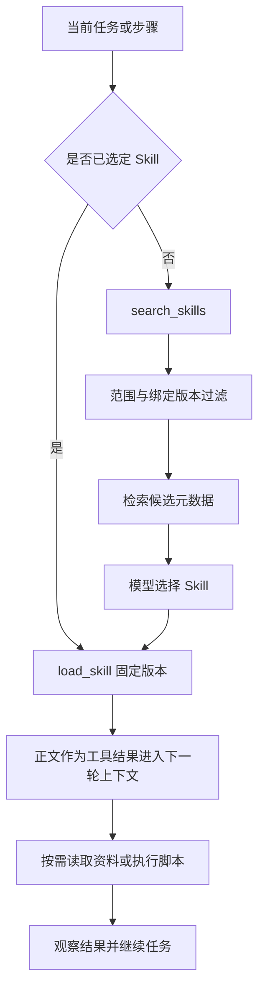

# 多租户 Skill 配置、存储与运行时加载

本文给出一套平台实现方案，以“为租户 A 生成本月经营报告”为贯穿示例。目标是让 Agent 在配置范围内找到合适的方法，按需加载正文和资源，同时保持管理配置、版本与实际执行一致。

Agent Skills 规范定义了包含 `SKILL.md` 的资源包，文件由元数据和操作正文组成，可以附带脚本、参考资料及模板。官方客户端指南采用目录元数据、完整指令、附属资源三层加载方式。下文的多租户表、搜索式目录和发布流程属于本方案的工程扩展。[Agent Skills 规范](https://agentskills.io/specification) · [客户端集成指南](https://agentskills.io/client-implementation/adding-skills-support)

## 职责边界

管理层提供上传、配置、授权和发布的管理入口，维护租户授权与 Agent 绑定关系。Skill 服务统一维护 Registry、不可变版本和资源包，提供查询、检索及加载接口。管理层调用这些接口展示资源，不另外保存一份 Skill 正文。

租户配置模块是管理层的一部分，为运行链路提供统一配置读取入口。请求先确定可信租户身份，再读取租户和 Agent 的有效配置，Skill 服务据此限制搜索与加载范围。身份传递和配置更新见 [租户配置服务与执行权限](../01-management/02-租户配置服务与执行权限.md)。

Runtime 根据当前任务发现 Skill，或直接加载已选定的绑定版本，接收正文后推进 Agent 循环。Skill 可以描述完整任务的方法与步骤，Runtime 管理执行状态、恢复、预算与停止条件。Context Assembler 管理实际进入输入的内容，工具服务检查实际操作权限及关键业务前置条件，沙箱工具负责受限文件访问和脚本执行。

这些都是逻辑职责。起步时可以共用一个后端进程和一套关系库，由模块分别维护自己的表。需要独立扩容或隔离资源读取时，再拆部署单元。

| 来源 | 所有权 | 可使用范围 |
| --- | --- | --- |
| 全局 Skill | 通常由平台维护 | 所有租户可配置使用 |
| 平台定制 Skill | 平台所有 | 平台授权的租户可配置使用 |
| 租户上传 Skill | 对应租户所有 | 本租户可配置使用 |

所有权回答谁维护内容，范围回答谁可使用。`owner_type` 取 `PLATFORM` 或 `TENANT`，租户所有时填写 `owner_tenant_id`。`visibility` 取 `GLOBAL` 或 `SCOPED`，限定范围再结合自有关系和授权记录判断。平台拥有的 Skill 可以是全局，也可以仅提供给指定租户。

租户可用范围按“全局 ∪ 本租户自有 ∪ 平台授权”计算，再与当前 Agent 启用集合取交集。示例中，平台通用报表 Skill 对所有租户可用，平台定制的经营口径 Skill 授权给 A，A 上传的报告排版 Skill 归 A 所有。报告 Agent 只选择需要的部分，其他可用 Skill 不自动加入。

## 数据模型与存储

关系库存放主记录、版本和配置关系，对象存储保存资源包。可以先采用四张表。

| 表 | 逻辑归属 | 关键字段 |
| --- | --- | --- |
| `skill` | Skill 服务 | `skill_id`、`display_name`、`owner_type`、`owner_tenant_id`、`visibility`、`status` |
| `skill_version` | Skill 服务 | `skill_version_id`、`skill_id`、`version_label`、`name`、`description`、`use_cases`、`tags`、`artifact_uri`、`content_hash`、`status`、`index_status` |
| `tenant_skill_grant` | 管理层 | `tenant_id`、`skill_id`、`status`、`granted_at`，记录平台向租户提供的限定 Skill |
| `agent_skill_binding` | 管理层 | `tenant_id`、`agent_version_id`、`skill_id`、`skill_version_id`、`enabled` |

`skill_id` 标识一项能力，版本 ID 标识具体内容。同名 Skill 可以并存，展示来源和描述帮助区分，绑定与加载始终使用 ID。`version_label` 方便人阅读，不能代替唯一版本 ID。

同一租户与 Skill 的授权记录保持唯一，同一 AgentVersion 中每项 Skill 只绑定一个版本。绑定时同时检查版本归属，避免 Skill ID 与另一资源的版本 ID 错误组合。

版本记录中的 `name` 和 `description` 从包内提取，适用场景和标签可以从平台配置或包的扩展元数据整理。它们随版本保存，避免修改当前名称或说明后，让旧版本被错误召回。

资源包按 Skill ID 与版本 ID 隔离存储，保留原目录结构。版本记录保存对象地址和内容摘要，资源清单列出 `SKILL.md`、参考文档、脚本及模板的相对路径。大文件正文留在对象存储，不放进绑定表。

检索索引是版本元数据的派生数据，可以重建。起步时直接利用关系库的全文索引，避免额外维护一份权威目录。启用独立搜索系统后，通过版本变更事件更新索引，记录处理进度与失败原因。

版本内部进一步分为召回信息、正文、资源清单和依赖声明，可在现有版本表中增加入口及清单字段，详见 [Skill 数据模型与资源依赖](./02-Skill数据模型与资源依赖.md)。

## 上传发布与版本绑定

上传入口统一接收平台包或租户包，按来源确定所有权。校验 `SKILL.md` 格式、资源路径和包大小后，将包写入不可覆盖的版本路径，计算摘要并保存版本元数据。

随后生成该版本的检索文档。只有资源可读取、索引就绪且版本已经发布，才允许出现在搜索结果中。可将版本状态分成待发布、已发布、已停用，索引状态单独记录，避免“上传成功”被误解为“运行时已经可用”。索引失败可重试，控制台显示未就绪原因。

平台为租户开通定制 Skill 时维护 `tenant_skill_grant`，租户自有与全局 Skill 无需逐个补授权记录。Agent 配置界面展示合并后的可用集合，选定具体版本，写入绑定关系。

发布 AgentVersion 时校验所选版本仍已发布、可用且环境兼容，将绑定作为发布快照固定。发布后的绑定不原地修改，启用新 Skill 或升级版本时生成新 AgentVersion。新 Run 使用新配置，正在运行的 Run 保持原有版本引用。

因此，报告 Skill 发布新版本后，已有报告 Agent 不会自动换用。需要停用问题版本时更新其可用状态，运行时加载会再次确认。对象存储和索引无法原子提交时，先保存未就绪记录，完成后再发布，遗留文件可以按未引用对象清理。

## 大量Skill的检索与召回

检索围绕当前任务或步骤进行。模型可以先搜索“月度经营报告”，执行到口径计算时再搜索“收入退款统计口径”，无需每次重复提交完整对话。

服务端从可信执行上下文取得租户、AgentVersion 和绑定版本，不让模型通过参数指定其他租户。先计算可用范围与启用集合，再对这些确切版本检索。过滤应进入查询条件，不能先搜索全库的 Top K，再删除不符合范围的结果。

搜索字段以名称、描述、适用场景和标签为主。描述应说明解决什么问题、何时使用和主要产物。先用关键词与全文检索跑通，同义表达明显影响召回时，再加入向量检索与结果合并。索引按 `skill_version_id` 建文档，Agent 绑定旧版本时只能返回旧版本描述，不能用最新版说明召回旧包。

首次可返回 5—10 个候选作为配置示例，数量需结合目录规模、候选质量和上下文预算调整。返回名称、描述、适用场景、稳定 ID 与版本，完整正文留到加载时读取。示例搜索结果如下。

```json
{
  "items": [{
    "skill_id": "sk_monthly_report",
    "version": "sv_003",
    "name": "monthly-business-report",
    "description": "按已确认经营口径生成月度报告",
    "use_cases": ["月度经营分析"],
    "tags": ["经营", "月报"]
  }],
  "has_more": true
}
```

索引可能短暂滞后，返回前再确认候选仍有效，过滤后不足时按预算补取。没有合适候选时，可改写查询、补充分类或请求缺失信息，并限制补搜次数。仍未找到则返回无匹配，由 Agent 判断已有工具能否完成任务，或明确停止，不把排名第一等同于适合。

少量 Skill 可以直接提供元数据目录。大量 Skill 使用上述搜索入口，索引在上传和变更时构建，运行时不扫描所有包，也不把全部目录塞进 Prompt。

## Runtime的按需加载

Runtime 可以提供 `search_skills(query)`、`load_skill(skill_id, version)` 两个通用工具及简短用法说明。需要发现方法时，模型先搜索、选择候选，再加载正文；任务入口或用户已选定 Skill 时，直接通过受支持的入口加载正文，无需重复召回。两条路径都核对绑定版本和当前权限，租户及 Agent 范围由服务端确定，工具参数不承担范围选择。



加载服务核对所选版本与绑定一致且当前仍可用，按版本地址读取并校验包。返回正文、Skill ID、版本、内容摘要、资源基准位置及简短资源清单。模型收到工具结果后，下一轮才具备这份操作说明。官方指南支持通过文件读取或专用激活工具，把指令作为工具结果交给模型。[Skill 激活与资源读取](https://agentskills.io/client-implementation/adding-skills-support#step-4-activate-skills)

加载失败区分版本停用、临时读取失败和包内容缺失。临时故障可以有限重试，停用或内容缺失则向 Agent 返回明确原因，由 Runtime 按错误类别继续、等待或停止，不静默改用最新版或其他同名包。

报告示例中，模型先选择并加载经营报告 Skill，依据正文读取口径说明，调用已有数据工具取数，再用沙箱中的脚本整理表格，最后按模板输出报告。加载正文不执行脚本，脚本仍由已有执行工具调用。无需为每个 Skill 注册一个独立模型工具，Skill 的工具声明也不自动增加工具权限。

相对资源路径按当前包的基准目录解析。挂载只表示文件在环境中可访问，正文和参考文件只有被读取并提交后才进入上下文。可按需下载整包到版本缓存目录，也可由资源接口读取单个文件，进入模型输入的内容仍按步骤选择。

加载记录保存 Skill ID、版本和上下文位置，仅对实际仍在上下文中的同版本内容去重。正文被压缩或移除后，应允许重新加载，不能因为历史上激活过就只返回“已加载”。文件缓存可以继续命中，但缓存存在不能代替上下文注入。

SDK 路径需要确认能接入这两个工具及接收工具结果。具备原生 Skill 装载能力时可由适配器映射，不必叠加第二套循环。SDK 内部上下文不可见时，记录可见加载事件，不把历史调用记录当作正文仍驻留的证明。

服务接口与 Worker 缓存如何配合、文件读取和模型输入如何分别优化，见 [Skill 渐进式加载与缓存](./03-渐进式加载与缓存.md)。

## 对应案例

- [召回与目录元数据](../../case/08-skills/01-召回与元数据.md)
- [资源缺失与按需读取](../../case/08-skills/02-资源缺失与按需读取.md)

[返回 Skill 模块](./README.md) · [上下文管理](../04-context/README.md) · [返回知识清单](../README.md)
