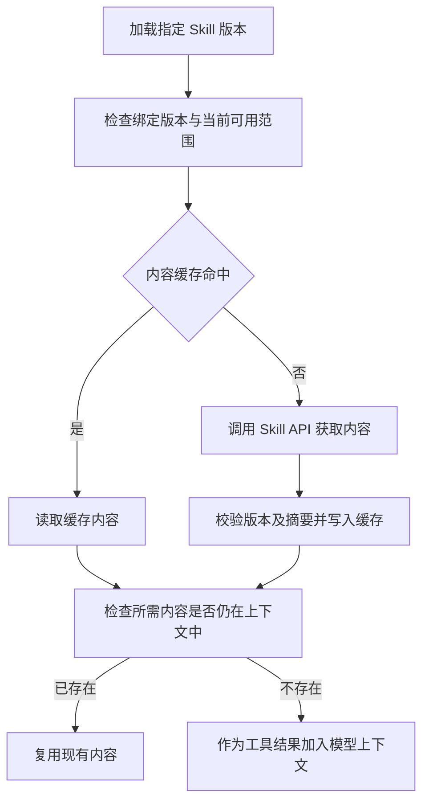

# Skill 渐进式加载与缓存

Skill 内容分为候选描述、执行正文和附属资源。需要发现方法时使用候选描述；任务入口或用户已选定 Skill 时，可以直接加载绑定版本正文。缓存减少获取文件的开销，上下文管理控制实际提交给模型的内容；两者分别记录和优化。本文沿用 [Skill 数据模型与资源依赖](./02-Skill数据模型与资源依赖.md) 中的版本结构。

## 服务接口与部署边界

Skill 可以先作为管理后端的独立模块，提供目录检索与内容接口，由 Runtime Worker 调用。多个运行服务共享目录时，也可以独立部署 Skill 服务。服务拆分不改变内容模型，是否拆进程按负载和运维需求决定。

模型侧可用 `search_skills(query)` 与 `load_skill(skill_id, version)` 两个通用入口。Runtime 在服务端绑定可信租户与 AgentVersion；版本参数对应配置中固定的版本标识。具体查询、对象存储读取和缓存命中对模型透明。

Skill 服务提供的内部 API 可以返回正文和资源清单；附属文件通过资源读取接口或已挂载目录访问。两个模型工具不代表底层只有两个 HTTP 接口，也不要求每次加载都产生远程请求。官方接入指南支持云端 Agent 从 API、远程目录等来源发现 Skill；本文的搜索、加载接口与缓存策略由平台实现。[Skill 接入指南](https://agentskills.io/client-implementation/adding-skills-support)

## 从召回到资源使用

下表中的搜索阶段按需发生。直接加载路径跳过搜索，但仍检查版本、权限和内容预算。

| 阶段 | 模型获得什么 | Runtime 执行什么 |
| --- | --- | --- |
| 按需搜索 | 少量候选的名称、描述、标签和固定版本标识 | 在租户与 Agent 允许范围内检索版本元数据 |
| 加载正文 | 选中版本的操作说明和必要资源位置 | 确认当前可用，获取并解析 `SKILL.md`，作为工具结果加入下一轮上下文 |
| 读取资料 | 当前步骤需要的参考内容 | 按包根目录解析路径，通过文件或资源工具读取 |
| 使用脚本和模板 | 工具执行结果、必要的结构或错误信息 | 准备文件和环境，在沙箱中运行脚本或调用文件生成工具 |
| 加载依赖 Skill | 被引用 Skill 的正文 | 按已确认的绑定版本执行相同加载流程 |

元数据、正文、附属资源的分层来自 Agent Skills 的渐进式加载方式；较长的详细内容可以放入引用文件，保持主正文聚焦于步骤和必要约束。[Agent Skills 规范](https://agentskills.io/specification)

经营报告 Skill 可以先说明“计算指标前读取 `references/metrics.md`”。模型执行到该步骤时发起读取调用，Runtime 返回口径文本，内容随后进入模型上下文。脚本和模板主要供工具使用，不必把整个包都转换成模型输入。

本地目录只表示文件可访问，模型仍需通过受支持的工具获得内容。正文读取失败时，Runtime 返回失败原因，不能把文件已下载或包已挂载当作正文已成功加载。

## 内容缓存与上下文驻留

先在 Worker 使用有容量限制的内存或本地文件缓存即可。正文适合内存缓存，脚本、模板和资源包适合本地文件缓存；是否增加共享缓存取决于实际重复读取量。

| 状态 | 标识和作用 | 边界 |
| --- | --- | --- |
| 不可变内容缓存 | 以 `skill_id + skill_version_id + content_hash` 定位版本内容；单文件缓存再带相对路径 | 命中后仍需确认当前访问范围；新版本使用新键 |
| 配置与授权缓存 | 按租户、AgentVersion、策略修订号等区分 | 与内容缓存分开，撤权或停用不能因文件命中而被忽略 |
| 上下文加载记录 | 在当前会话或执行上下文中记录资源版本、加载范围和消息位置 | 仅当内容仍保留时避免重复注入；不能用跨 Run 的全局“已加载”标记 |

内容缓存由 Runtime 管理，受限包的文件只提供给获授权的执行环境。已发布版本的内容不覆盖修改，缓存可按容量和最近使用情况淘汰；文件被淘汰只影响下次读取时延。

版本缓存保持只读。脚本需要修改输入文件、填写模板或写入产物时，复制必要文件到任务工作区或显式指定工作区输出路径，避免执行过程修改共享缓存中的固定版本。

正文被上下文压缩或移除后，可以从文件缓存快速重新注入。历史上成功调用过 `load_skill`，并不证明正文仍在当前模型输入中。SDK 无法暴露内部上下文时，通过适配器支持的重新加载方式处理，不依据历史事件声称内容仍驻留。

本地内容缓存不会自动减少提交给模型的 Token。模型服务提供的 Prompt Cache 属于另一层机制，其支持条件和收益需要单独确认。

## 长文本与运行时延

Skill 带来的开销可以分开观测，避免把所有耗时都归到读取接口。

| 开销 | 主要来源 | 优化方向 |
| --- | --- | --- |
| 获取内容 | 网络、服务排队、关系库或对象存储读取 | 版本缓存、连接复用、减少不必要的跨区域读取 |
| 发现与选择 | 搜索、选中、加载可能引入额外模型轮次 | 任务入口已明确或用户已选定的 Skill 可以直接加载，其余按需发现 |
| 模型处理 | 正文和资料增加模型输入量，占用上下文预算 | 主正文保留核心步骤，详细资料按需读，避免重复注入 |

文件字节数主要影响传输与存储，模型 Token 数影响输入处理和上下文空间，两者不是固定比例。将文件放到 Runtime 本地后，仍需控制进入模型的内容量。

也要区分两种“提前加载”：

- 预取文件：提前把少量常用版本放入本地缓存，减少后续读取等待，不把正文加入模型输入。
- 预先提供正文：确定当前任务需要某个 Skill 时，通过 Runtime 支持的入口直接提供正文，减少发现与激活轮次，同时增加本轮输入量。

经营报告入口已确定使用报告 Skill 时，可以直接加载其绑定版本；通用助手面对开放任务时，保留搜索和按需加载。预取范围与缓存容量都应有限，不在每次启动时读取全部 Skill 包。

## 观测与验证

Trace 区分搜索、内容读取、正文注入和模型调用，关联 Run、Skill ID 与版本。至少记录搜索和加载 API 的耗时分布、缓存命中情况、发现与加载轮次、可见输入 Token、模型首 Token 时延，以及任务总耗时和完成质量。估算的 Token 单独标记；SDK 未暴露的内部调用与输入用量标为未知。

比较策略时使用相同任务与版本，分别观察首次未命中和缓存命中的情况。内容读取慢时优化 I/O；发现轮次多时调整预选或直接加载；输入过大时拆分资料、减少重复。优化需要保留任务必需的规则与资源，不能仅以降低 Token 或接口耗时判断效果。

## 对应案例

- [正文成功加载但未完整进入模型输入](../../case/04-context/01-Skill正文被工具结果截断.md)
- [激活集合与权限守卫不一致](../../case/03-execution/01-Skill激活集合与工具授权.md)

[返回 Skill 模块](./README.md) · [Skill 数据模型与资源依赖](./02-Skill数据模型与资源依赖.md) · [上下文管理](../04-context/README.md) · [返回知识清单](../README.md)
