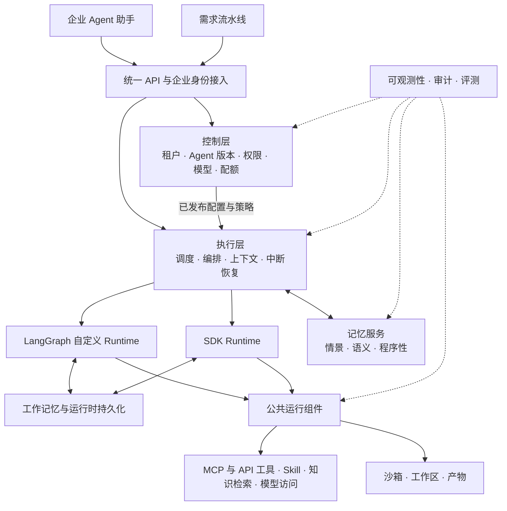

# 企业 Agent 基座架构与面试复习

这套基座沿用你提出的四部分设计，包含控制层、执行层、记忆服务和公共组件。它能够同时支撑企业 Agent 助手与需求流水线，功能范围覆盖配置发布、授权执行、记忆积累、工具和环境管理、结果留存及质量验证。

“小而全”落实在部署和实现方式上。先以少量服务和成熟基础设施承载完整职责，通过清晰接口保留拆分空间。下文是共同整理的目标设计，实施范围、个人贡献和上线日期需与实际项目记录对应。本文整理于 2026 年 11 月 14 日，引用的当前资料用于验证设计边界，7 月交付范围在时间线中单独确认。

## 对这个设计的判断

整体划分合理。控制层回答“谁能配置和使用哪些能力”，执行层回答“一次任务如何运行”，记忆服务回答“哪些信息值得保留及如何复用”，公共组件提供实际动作、环境和治理能力。企业助手与需求流水线可以共享这套基座，各自组织业务入口和完成条件。

进一步细化时，重点明确以下边界。

| 容易混淆的部分 | 本方案的划分 |
| --- | --- |
| 模型配置与模型调用 | 控制层管理模型目录和策略，执行路径落实调用、限流、降级与用量记录 |
| 上下文与记忆 | 执行层组装本次上下文，Runtime 持有工作状态，记忆服务管理长期条目 |
| 工具、Skill 的管理与使用 | 控制层提供注册和发布入口，运行组件负责装载、鉴权和调用 |
| 权限与可观测性 | 权限策略由控制层定义，各访问点执行检查，观测贯穿整个运行链路 |
| 基座编排与业务流程 | 基座提供通用编排与 Run 生命周期，上层维护需求、验收和发布等业务状态 |

四层记忆采用你确认的工作记忆、情景记忆、语义记忆和程序性记忆。这里的“层”表示四类职责，数据可以共享存储基础设施。它参考工作记忆加三类长期记忆的概念框架，具体生命周期按本项目需求设计，详见 [四层记忆服务](./memory/README.md)。

## 总体架构



图中的工作记忆与运行时持久化表示一类职责。LangGraph 和 SDK 分别维护各自的恢复数据，适配器管理引用和兼容性。执行层的 Context Assembler 调用记忆与知识服务，决定哪些内容进入本次模型输入。SDK 内部上下文管理按其开放能力接入。

公共组件各自提供管理接口和运行接口。管理界面可以集中在控制台，底层服务通过统一身份和版本引用连接。模型网关、工具网关、记忆服务等逻辑模块可按团队技术栈合并部署。

[上下文与渐进式加载](./context/README.md)作为执行层内的独立职责展开，统一协调工具定义、Skill 指令、知识片段与产物内容的按需装载。资源的注册、授权、索引及存储由各模块负责，进入本轮模型请求的材料由上下文模块按任务和预算选择。

## 四部分的职责与核心对象

| 部分 | 主要职责 | 核心对象 |
| --- | --- | --- |
| 控制层 | 租户和工作区、身份权限、Agent 发布、模型与能力目录、审批规则、配额 | Tenant、Workspace、Agent、AgentVersion、Policy、ModelProfile |
| 执行层 | 任务调度、流程编排、Agent 循环、上下文组装、Runtime 适配、等待恢复、取消与事件 | Session、Run、Attempt、CheckpointRef、RunEvent |
| 记忆服务 | 长期记忆候选、发布、检索、更正、撤销与删除，关联运行中的工作记忆 | MemoryEntry、MemoryVersion、SourceRef、Scope |
| 公共组件 | 企业工具、Skill、RAG、模型访问、沙箱、产物、观测与评测 | ToolVersion、SkillVersion、EnvironmentTemplate、Artifact、Trace、Evaluation |

### 统一运行对象

- **AgentVersion** 是不可变的发布版本，固定 Prompt、Skill、流程和依赖引用。
- **Session** 承载连续交互，包含多个 Run，并关联执行器会话。
- **Run** 表示一次逻辑调用，固定 AgentVersion。人工补充信息和失败恢复可以延续该 Run。
- **Attempt** 表示一次 Worker 执行尝试，承担租约、环境和执行所有权。一个 Run 可有多个 Attempt。
- **external_ref** 关联需求 Task、工单等上层业务对象，业务状态由对应应用维护。

服务端建立可信执行上下文，传递 `tenant_id`、`workspace_id`、`subject`、`agent_version_id`、`session_id`、`run_id`、`attempt_id`、`trace_id` 及策略、凭证引用。运行中的凭证按需获取，模型与工具输入不能覆盖身份字段。

同一 Session 默认串行修改会话状态。并行子任务使用独立上下文和子 Run，通过父子关系汇总结果、权限及用量。

## 用一条需求串起所有模块

以“订单列表增加创建人筛选”为讲解例子，具体业务样例可替换成真实项目记录。

1. 需求流水线保存范围、验收条件和仓库基线，调用基座时传入 `external_ref`。
2. 控制层校验身份、资源授权、发布版本和额度，将可信配置交给执行层。
3. 执行层幂等创建 Run，持久化后排队。Worker 取得租约，建立 Attempt 和工作区。
4. 上下文组装器读取当前输入与工作状态，检索相关经历、项目约定和知识证据，装载已发布的操作方法。
5. Runtime 推进计划、模型调用和工具循环。企业工具经过参数校验与授权，命令和脚本在限定环境内执行。
6. 需要人工输入时持久化等待状态，恢复前核验当前权限、执行环境和未决外部操作。
7. 结果与必要产物持久化后，执行层提交 Run 终态，上层继续安排 CI、审查、业务验收和发布。
8. 记忆服务基于执行结果及后续验证记录提炼候选。已确认事实和可复用经验按规则发布，程序性改进形成新的 Skill 或 Prompt 版本。

一次任务中，工作记忆跟踪当前修改与测试，情景记忆记录这次经历，语义记忆保存确认过的项目约定，程序性记忆提供已发布的实现和检查方法。验证尚未完成的结论保留待验证状态，后续结果到达后更新。

## 小规模部署建议

结合现有笔记中的技术栈，可以先采用下面的部署方式。表中是实现选项，最终选择以团队已有设施和实际部署记录为准。

| 部署单元 | 首期承载职责 |
| --- | --- |
| Web 工作台 | Agent 配置、运行交互、审批、产物与观测入口 |
| Java / Spring Boot 后端 | 企业接入、控制层、Run 元数据与调度、工具治理、产物元数据、业务集成 |
| Python 服务及后台 Worker | LangGraph 图、上下文组装、已有 RAG、记忆查询与异步提炼 |
| SDK Worker 与执行环境 | SDK 适配、会话和工作区管理、代码与命令执行、事件及产物回收 |

已有关系库可保存平台配置、运行状态、权限、记忆主记录与 outbox。对象存储保存文件和归档，检索系统保存可重建索引。队列承担调度信号传递，缓存承担加速，任务权威状态落在持久化存储中。

checkpoint 与 SDK 会话需要各自兼容的持久化方案。选型时验证框架支持的存储、恢复语义和升级兼容性，再决定复用已有设施或增加对应存储。SDK 的本地会话目录如用于跨进程恢复，需有持久化、隔离、访问控制及备份安排。

模块拆分的触发条件是独立扩缩容、故障隔离或维护边界。例如编码 Worker 资源波动较大，可以先独立扩容，配置和目录管理继续放在同一后端。

## 功能齐全如何落到验收

| 能力 | 最小可验证结果 |
| --- | --- |
| 控制层 | 能创建租户与工作区、发布 Agent、回滚版本、撤销权限、配置模型和配额 |
| 执行层 | 能运行顺序、条件、并行和人工等待流程，故障后恢复，重连查询，取消并核对副作用 |
| 四层记忆 | 能使用工作状态、提炼经历、修订事实、装载程序性版本，并执行作用域过滤和撤销 |
| 工具与 Skill | 能完成注册、版本固定、鉴权调用、失败分类、升级与回滚 |
| 环境与产物 | 能隔离执行、保存恢复材料、提交可校验产物，并在结束后回收环境 |
| 观测与评测 | 能按 Run 排查问题，区分执行完成与业务验收，比较版本的质量及成本 |

这张表用于设计验收和梳理实施证据。正式面试时，每项选择实际完成的功能和一个具体案例展开，能说明配置、执行结果及故障处理即可。

## 面试时的整体讲法

> 基座我按四部分设计。控制层管理租户、Agent 发布版本、权限和模型配置，执行层负责调度、编排、工具调用、上下文和中断恢复。底层通过适配器接入 LangGraph 自定义 Runtime 或成熟 SDK，统一任务入口与结果，同时保留后端能力差异。
>
> 记忆采用工作、情景、语义和程序性四类。工作记忆跟随运行状态，长期记忆通过独立生命周期管理。公共组件提供 MCP 工具、Skill、知识检索、沙箱、产物和观测评测。
>
> 这些模块通过统一的租户身份、版本引用和 Run 标识连接。部署上先合并通用管理模块，执行资源按需独立扩容。企业助手和需求流水线共享基座，分别维护自己的业务入口和验收条件。

## 模块目录与阅读顺序

每个模块有独立目录和 `README.md` 入口。先阅读控制层、执行层和上下文，再按需要进入记忆与各公共组件。目录划分用于明确职责及承载后续细节，部署方式按前面的方案决定。

```text
base/
├── README.md
├── control-plane/       控制层
├── execution/           执行层与跨模块故障处理
├── context/             上下文管理与渐进式加载
├── memory/              四层记忆
├── mcp/                 MCP 与企业工具
├── skills/              Skill 管理
├── knowledge/           知识与检索
├── models/              模型接入与调用治理
├── sandbox/             沙箱与工作区
├── artifacts/           产物管理
├── observability/       可观测性
└── evaluation/          评测与质量验证
```

| 模块入口 | 主要内容 |
| --- | --- |
| [控制层](./control-plane/README.md) | 租户、身份、Agent 配置发布、权限审批、配额与审计 |
| [执行层](./execution/README.md) | 编排、调度、Runtime 适配、Run 生命周期、中断恢复 |
| [上下文与渐进加载](./context/README.md) | 资源发现、按需装载、上下文预算、裁剪与 Runtime 能力边界 |
| [四层记忆](./memory/README.md) | 工作、情景、语义、程序性记忆及读写生命周期 |
| [MCP 与工具](./mcp/README.md) | 工具目录、schema 装载、鉴权调用、幂等与结果核对 |
| [Skill](./skills/README.md) | 能力包、版本发布、渐进装载、脚本和程序性记忆关联 |
| [知识与检索](./knowledge/README.md) | 知识源同步、解析索引、授权召回、证据片段与版本 |
| [模型接入](./models/README.md) | 模型能力、调用适配、限流重试、降级与用量 |
| [沙箱与工作区](./sandbox/README.md) | 环境模板、隔离、凭证、文件恢复与资源回收 |
| [产物](./artifacts/README.md) | 文件归档、元数据、按需读取、下载授权与保留策略 |
| [可观测性](./observability/README.md) | 事件、日志、链路、指标与排障 |
| [评测](./evaluation/README.md) | 样本、版本回归、线上复核与验收口径 |

跨模块协作见 [组件协作与故障处理](./execution/组件协作与故障处理.md)。

## 模块文档扩展方式

各模块的 `README.md` 保存职责、已有设计、协作关系和后续细化专题。讨论具体实现时，在对应目录增加专题文档，并在该模块入口登记链接。

优先围绕数据模型与接口、核心执行流程、权限与版本、存储与一致性、故障恢复与验收逐步展开。跨模块规则放在负责该规则的模块，调用方通过链接说明依赖。例如资源加载策略归上下文模块，产物保存和读取接口归产物模块。

原项目业务链路见 [企业 Agent 项目主线](../01-企业Agent项目主线.md)，月份与交付范围见 [项目时间线](../time-line/企业Agent项目时间线.md)。本目录用于细化基座设计，旧主线中的范围表述按最新确认的实际实施情况更新。
