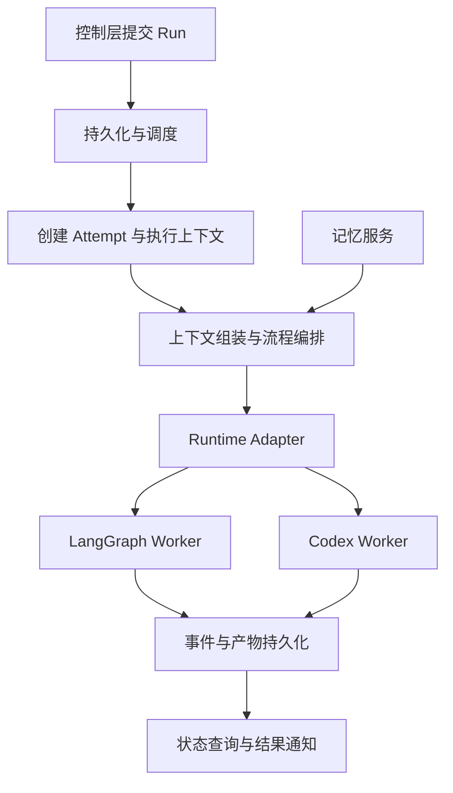

# Agent 基座执行层设计

执行层把已发布的 AgentVersion 转化为可调度、可中断、可恢复的运行，覆盖上下文组装、流程编排、Runtime 适配、Worker 和结果回收。控制层保存配置与策略，记忆服务管理记忆数据，公共组件提供模型、工具、存储和观测能力。

本文是设计建议。官方资料核对于 2026 年 11 月 14 日，当前能力用于解释接口边界，项目在 2026 年 7 月实际具备的功能须核对当时版本和实施记录。

## 运行对象与可信上下文

| 对象 | 统一含义 | 生命周期要求 |
| --- | --- | --- |
| AgentVersion | 不可变的发布版本 | 固定 Prompt、Skill、流程和依赖引用 |
| Session | 连续交互的会话 | 包含多个 Run，关联执行器会话与历史 |
| Run | 一次逻辑调用 | 固定 `agent_version_id`、输入和执行策略引用 |
| Attempt | 一次 Worker 执行尝试 | 分配工作区、租约和执行所有权令牌 |
| external_ref | 上层业务关联 | 关联需求 Task、工单等业务对象 |

一次 Run 可以经历多个 Attempt。等待人工输入后继续原调用，仍归属原 Run。用户提交新的逻辑请求会创建新 Run。Session 内默认串行修改会话状态，并行子任务使用独立执行上下文。

执行上下文由服务端建立，携带 `tenant_id`、`workspace_id`、`subject`、`agent_version_id`、`session_id`、`run_id`、`attempt_id`、`trace_id` 和策略引用。模型输入不能覆盖这些身份字段。配置版本固定，实际资源访问仍需检查权限撤销与策略有效性。

## 一次运行的执行链路

提交时校验发布版本、输入结构、调用身份及预算。Run 和待投递事件在同一事务内保存，再异步送入队列。Worker 原子取得所有权并创建 Attempt，再准备环境。结束时先保存结果与产物引用，再提交终态和通知事件。

队列负责传递待执行信号，数据库保存运行状态。重复投递通过条件领取与状态校验处理。执行层完成 Run 后，上层需求流水线继续管理审查、业务验收和发布。

## 上下文组装

Context Assembler 读取 AgentVersion 中的上下文策略，并按可信身份调用记忆和知识服务。它组织当前输入、会话工作状态、相关历史经历、事实知识、已发布操作方法及工具定义，记录来源、版本和裁剪情况。

组装时先执行访问过滤，再按相关性和 token 预算选择内容，给当前任务、工具结果和最终输出预留空间。大型工具结果转为摘要与产物引用。来自文档、记忆和工具的内容保留来源标签及指令优先级，权限判断由服务端执行。

LangGraph 图可以在指定节点重新组装上下文。Codex 由自身 Harness 管理内部上下文，适配层负责初始输入、授权工具、Skill 和资料引用，并接收可用的运行事件。各执行器的内部状态分别持久化。

渐进式发现、资源装载、上下文预算与裁剪在 [上下文管理模块](../context/README.md) 中展开。

## 流程编排与 Runtime 适配

流程模板随 AgentVersion 发布，节点定义输入输出结构、依赖、超时、重试和失败出口。

Agent 节点内部执行模型调用、工具选择、参数校验、授权审批、工具执行和结果反馈的循环。每轮检查剩余预算与停止条件，结构化输出通过 schema 校验后才能进入下一节点。工具异常转换为明确的错误类型，供流程规则或模型决定后续处理。LangGraph 路径由团队实现这些节点逻辑，Codex 路径通过 Harness 能力和适配接口落实。

| 编排能力 | 执行规则 |
| --- | --- |
| 顺序与条件 | 前置结果提交后推进，条件使用已保存的结构化结果 |
| 并行与汇聚 | 限制并发，预先定义等待全部或部分成功、失败分支处理及结果合并规则 |
| 人工等待 | 保存等待原因、审批动作、参数摘要、授权范围与恢复点 |
| 子任务 | 创建子 Run，固定目标 AgentVersion，继承并收窄权限和预算，记录父子关联 |

LangGraph 执行器基于框架实现自定义图、节点和 Agent 逻辑，复用持久化与中断机制。人工恢复可能重新执行所在节点，外部写入应具备幂等保护。[LangGraph 持久化文档](https://docs.langchain.com/oss/python/langgraph/persistence) · [人工中断文档](https://docs.langchain.com/oss/python/langgraph/interrupts)

Codex 执行器通过 SDK 复用成熟 Harness，承担代码分析、文件操作与工具执行。需要更细的审批、事件和生命周期控制时，可以实现 App Server 适配。部署时固定 SDK 与运行时版本，提供工作区及会话持久化安排。[Codex SDK](https://learn.chatgpt.com/docs/codex-sdk) · [Codex App Server](https://learn.chatgpt.com/docs/app-server)

适配器对外提供 `start`、`stream`、`cancel`、`resume` 和结果查询，并声明恢复、持久化等待、工具注入、模型选择等能力。发布和调度时校验所需能力，不支持的组合返回明确错误。切换 Runtime 时创建采用相应配置的新 Run 和执行上下文，显式选择可传递的输入与产物，并关联原 Run。模型或供应商变更也按后端支持方式处理，保留原会话和版本记录。

## Run 状态与调度所有权

Run 的主路径为 `QUEUED → RUNNING → SUCCEEDED`。需要输入时进入 `WAITING`，可重试故障进入 `RETRY_WAIT`，恢复后重新排队。不可恢复故障进入 `FAILED`。取消与超时先进入 `CANCELLING`，完成停止确认后分别进入 `CANCELLED` 或 `TIMED_OUT`。

每次领取以条件更新取得租约，生成递增的 fencing token。心跳续租、状态更新和产物提交都校验当前 Attempt 与 token。旧 Worker 租约失效后可能仍在运行，调度器需要终止或隔离旧实例，受控工具服务拒绝旧 token 的新写入。

每个 Session 的状态写入也需要串行控制，避免两个 Run 同时改写同一 Runtime 会话。并行节点使用独立结果区，汇聚节点按既定规则提交。

重试按错误分类执行。短暂网络错误可以退避重试，输入错误返回调用方，授权失败等待重新授权。模型调用、节点和 Worker 的重试共用上限与截止时间，防止多层重试放大成本。

队列按租户配额、优先级和入队时间调度，限制排队长度与并行 Attempt 数。子任务预留的预算计入父 Run 总额，实际模型与工具用量回收后更新余额。预算耗尽时停止新增调用，并保存已经产生的结果。

## 外部副作用与恢复

checkpoint 保存的是执行状态。工具已经完成写入但确认响应丢失时，恢复过程需要查询外部结果。LangGraph 官方也明确要求对节点重试中的副作用设置幂等与结果核对机制。[LangGraph 故障恢复文档](https://docs.langchain.com/oss/python/langgraph/fault-tolerance#retry-boundaries-and-idempotency)

写操作先持久化操作意图、稳定操作 ID、参数摘要和目标资源，再调用外部服务。操作 ID 跨 Attempt 保持一致。外部支持幂等键时直接使用，否则结合业务唯一约束、受控串行化和结果查询。

例如创建 MR 超时后，将操作标记为结果待核对，查询目标仓库的分支、任务标识及 MR。匹配成功则补写结果，确认未执行后重试，持续不确定则转人工处理。fencing 可以拒绝过期实例后续发起的写入，已经发出的请求仍需对账。

恢复前核对 AgentVersion、Runtime 版本、checkpoint/session 数据、工作区版本、产物清单和未决操作。可恢复时创建新 Attempt 接续原 Run。恢复数据不兼容时，只有具备可验证的阶段起点、完整输入与工作区材料，并完成副作用核对，才允许按原固定配置重放相应阶段。条件不足则明确失败或转人工处理，保留原因。需要更换 AgentVersion 或 Runtime 的重建创建关联的新 Run。

## 等待、超时和取消

支持持久化暂停的执行器在保存恢复点后释放 Worker。审批结果绑定具体动作、参数及授权范围，恢复时重新校验。依赖活动进程的审批采用有期限的在线等待，或调整为具备持久化边界的流程节点。

任务记录总截止时间、阶段时限、工具超时和预算。取消意图先持久化，随后停止派发节点和新的外部写入，并向 Runtime、子进程及子任务发送停止请求。无法确认停止时保留取消中状态及异常原因。已发生的外部操作继续记录和核对。

完成与取消并发到达时，通过状态版本条件更新确定先被接受的转换。终态保留唯一结果，较晚的请求记录为事件，防止已经成功的 Run 被迟到的取消或旧 Attempt 回调覆盖。

## 事件、工作区与产物

状态变化和关键事件事务性保存，通过异步发布通知订阅者。事件带 `run_id`、`attempt_id`、序号、类型和时间。重连先取得带游标的状态快照，再读取后续事件，使用持久化事件流覆盖历史补取与实时订阅之间的间隙，并按事件 ID 去重。

checkpoint/session 用于运行恢复，artifact 用于保存输入输出文件、代码补丁、报告和测试记录。每项产物保存归属、内容摘要、来源 Attempt、生成版本与存储引用。成功终态提交前确认必要产物已持久化，临时环境在归档后清理。

Worker 使用独立工作区、受限身份、资源额度和网络策略。工具网关控制企业接口访问，原生 Shell 与文件工具还受执行环境限制。凭证按任务范围注入，生产写入和 Git 交付动作通过受控服务完成。环境策略覆盖原生工具直接访问外部资源的路径。

## 面试时讲清的五个问题

1. Run 表示哪次逻辑调用，失败重试为什么生成新的 Attempt？
2. 哪些编排机制由基座提供，哪些需求阶段由上层维护？
3. 两种 Runtime 如何协商能力，恢复数据分别存在哪里？
4. 旧 Worker 未停止、外部请求结果不确定时怎样处理？
5. 页面重连、人工等待和任务取消如何保持状态一致？

## 模块协作与后续细化

运行依赖 [控制层](../control-plane/README.md) 的配置与授权，调用 [模型模块](../models/README.md)、[MCP 工具](../mcp/README.md) 和 [记忆服务](../memory/README.md)，通过 [沙箱](../sandbox/README.md) 与 [产物服务](../artifacts/README.md) 保存恢复条件和执行结果。跨模块故障见 [组件协作与故障处理](./组件协作与故障处理.md)。

后续按以下专题细化。

- Session、Run、Attempt、事件与操作记录的数据模型和接口。
- 调度、租约、fencing、并行汇聚和子任务预算。
- LangGraph 与 SDK 的适配接口及能力矩阵。
- 中断、恢复、取消、重连和外部操作对账。

[返回基座总览](../README.md)
